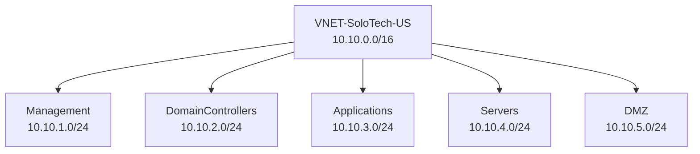

# Azure Resource Creation

## Project Objective

The objective of this phase was to design and deploy the foundational Azure infrastructure required to support future compute, monitoring, backup, security, and operational workloads.

The environment was designed using enterprise networking and segmentation principles rather than a flat network architecture.

---

# Project Scope

Resources deployed:

- Resource Group
- Virtual Network
- Subnets
- Network Security Groups

Region:

```text
North Central US
```

Subscription:

```text
Azure Subscription 2 Free Plan
```

---

# Resource Group Deployment

## Resource Group

Created:

```text
RG-Management-US
```

Purpose:

```text
Centralized management of Azure infrastructure resources.
```

Region:

```text
North Central US
```

---

# Virtual Network Deployment

## Virtual Network

Created:

```text
VNET-SoloTech-US
```

Address Space:

```text
10.10.0.0/16
```

Purpose:

Provide isolated network infrastructure for:

- Administrative systems
- Future Domain Controllers
- Application workloads
- Infrastructure servers
- Public-facing services

---

# Enterprise Network Design

## Subnet Architecture

| Subnet | Address Range | Purpose |
|----------|----------|----------|
| Management | 10.10.1.0/24 | Administrative workloads |
| DomainControllers | 10.10.2.0/24 | Active Directory services |
| Applications | 10.10.3.0/24 | Business applications |
| Servers | 10.10.4.0/24 | Infrastructure servers |
| DMZ | 10.10.5.0/24 | Public-facing workloads |

---

# Network Diagram



---

# Why This Design Was Chosen

Rather than using Azure's default subnet design, dedicated subnets were created to simulate a real-world enterprise environment.

Benefits:

- Improved security
- Easier administration
- Clear workload separation
- Future scalability
- Simplified monitoring and troubleshooting

---

# Naming Standards

## Resource Group

```text
RG-Management-US
```

Naming Convention:

```text
RG = Resource Group
Management = Purpose
US = Region
```

---

## Virtual Network

```text
VNET-SoloTech-US
```

Naming Convention:

```text
VNET = Virtual Network
SoloTech = Organization
US = Region
```

---

# Tags Applied

Standard governance tags were implemented.

| Tag | Value |
|----------|----------|
| Environment | LAB |
| Owner | SoloTech |

Purpose:

- Resource tracking
- Cost reporting
- Governance
- Operational visibility

---

# Challenges Encountered

## Region Availability Restrictions

Initial planning focused on:

```text
UK South
```

however subscription restrictions prevented deployment of required VM sizes.

Decision:

```text
Move infrastructure deployment to North Central US.
```

---

# Skills Demonstrated

- Azure Resource Groups
- Virtual Networks
- Address Space Planning
- Subnet Design
- Resource Tagging
- Azure Governance
- Enterprise Architecture Design
- Network Segmentation
- Infrastructure Planning

---

# Outcome

Successfully deployed:

✅ Resource Group

✅ Azure Virtual Network

✅ Enterprise Network Architecture

✅ Multi-Subnet Design

✅ Governance Tags

✅ Foundation for Azure Compute and Monitoring Projects
