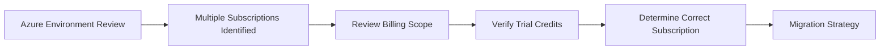

# Azure Subscription Management

## Project Objective

The objective of this phase was to ensure all Azure workloads were deployed into the correct subscription and governed under the Azure Free Plan.

This phase became an important real-world governance exercise involving billing scope validation, subscription analysis, and resource migration.

---

# Initial Environment

During deployment, two Azure subscriptions were discovered.

## Subscription 1

Original Azure subscription attached to the tenant.

Resources originally deployed:

```text
RG-Management
VNET-SoloTech
NSG-Management
NSG-Servers
```

---

## Subscription 2

Azure Free Plan subscription containing:

```text
Azure Free Services
Azure Trial Credits
Cost Controls
Budget Monitoring
```

---

# Issue Discovered

Infrastructure had been deployed into:

```text
Azure Subscription 1
```

while the Azure credits existed under:

```text
Azure Subscription 2 Free Plan
```

This would have resulted in:

```text
Networking Resources in One Subscription

Compute Resources in Another Subscription

Potential Billing Confusion
```

---

# Discovery Workflow



---

# Decision Process

Several options were evaluated:

## Option 1

Leave resources where they were.

### Risks

- Billing inconsistency
- Governance complexity
- Future migration requirement

---

## Option
