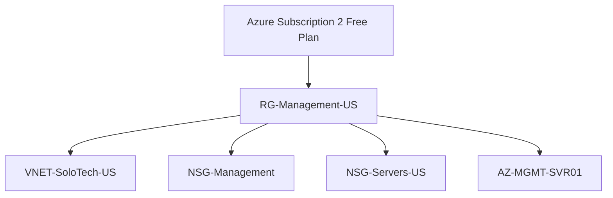

# Resource Clean-Up and Environment Standardisation

## Objective

Following the subscription migration process, resources from multiple regions existed within the environment.

The objective was to simplify the design and maintain a clean operational architecture.

---

# Situation

Resources existed across:

```text
UK South
```

and

```text
North Central US
```

This created unnecessary complexity.

---

# Challenges

Potential issues included:

- Region confusion
- Resource sprawl
- Operational overhead
- Future troubleshooting complexity

---

# Evaluation

Existing UK resources were assessed.

Resources reviewed:

```text
VNET-SoloTech
NSG-Management
NSG-Servers
NetworkWatcherRG
```

---

# Decision

Standardise infrastructure deployment into:

```text
North Central US
```

Reasoning:

```text
VM Availability
Supported SKUs
Lower VM Costs
Simplified Architecture
```

---

# Clean-Up Activities

Removed:

```text
Legacy UK Networking
Unused Test Resources
Mixed Region Components
```

Retained:

```text
RG-Management-US
VNET-SoloTech-US
NSG-Management
NSG-Servers-US
AZ-MGMT-SVR01
```

---

# Final State



---

# Benefits

- Cleaner administration
- Reduced operational confusion
- Easier future expansion
- Better governance

---

# Lessons Learned

Resource clean-up is a critical cloud administration skill.

A clean environment improves:

- Security
- Monitoring
- Governance
- Troubleshooting

---

# Skills Demonstrated

- Resource Lifecycle Management
- Environment Standardisation
- Operational Governance
- Cloud Administration
