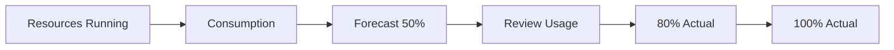

# Azure Budgeting and Cost Governance

## Project Objective

Implement proactive cost governance controls before deploying billable workloads.

---

# Why Budgeting Matters

The environment was being deployed within an Azure Free Plan subscription.

Available credit:

```text
£150+
```

Goal:

```text
Prevent Uncontrolled Spending
Monitor Consumption
Implement Governance
```

---

# Budget Creation

Budget Name:

```text
Azure-Lab-Budget
```

Monthly Limit:

```text
£10
```

---

# Alert Configuration

## Forecast Alert

Threshold:

```text
50%
```

Purpose:

Early warning based on projected spend.

---

## Actual Cost Alert

Threshold:

```text
80%
```

Purpose:

Warning threshold.

---

## Actual Cost Alert

Threshold:

```text
100%
```

Purpose:

Critical alert.

---

# Governance Workflow



---

# Additional Cost Controls

Implemented:

## Auto Shutdown

```text
07:00 Daily
```

---

## VM Deallocation

Used:

```text
Stop (Deallocate)
```

instead of:

```text
Windows Shutdown
```

---

## Subscription Monitoring

Enabled:

```text
Consumption Tracking
Cost Visibility
```

---

# Lessons Learned

Budgeting should be implemented before:

```text
Virtual Machines
Storage Accounts
Backups
Monitoring Workloads
```

---

# Skills Demonstrated

- Azure Cost Management
- Budget Administration
- Forecast Monitoring
- Governance Controls
- Financial Operations (FinOps)
