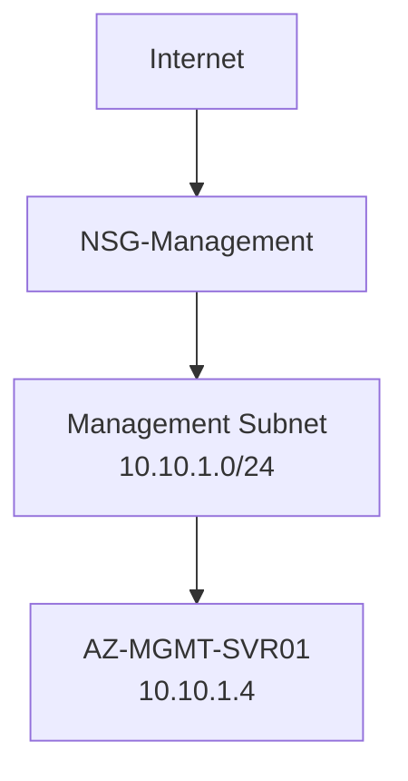

# Azure Mobile Administration

## Project Objective

Extend administrative capability beyond a desktop workstation by implementing mobile Azure management.

---

# Azure Mobile App

Installed and configured.

Functions:

- Resource Monitoring
- VM Status
- Alerts
- Resource Health
- Start/Stop Operations

---

# Microsoft Remote Desktop

Configured for:

```text
AZ-MGMT-SVR01
```

Capabilities:

- Remote Administration
- Troubleshooting
- Monitoring
- Ad-hoc Management

---

## Network Architecture



---

# Use Cases

- Service Health Checks
- Alert Monitoring
- VM Operations
- Incident Response

---

# Lessons Learned

Cloud infrastructure can be managed:

```text
Anywhere
Anytime
Any Device
```

provided governance and access controls exist.

---

# Skills Demonstrated

- Azure Mobile Administration
- Cloud Operations
- Remote Support
- Mobile Incident Management
