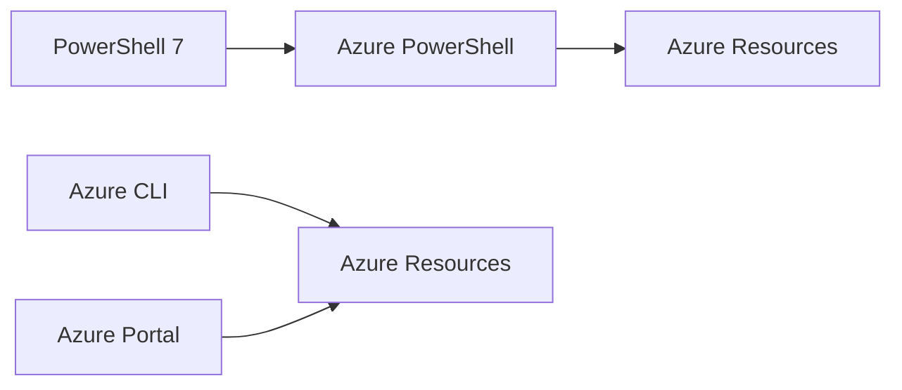

# Azure Administration Tooling

## Project Objective

Transform AZ-MGMT-SVR01 into a dedicated Azure Administration Workstation.

---

# PowerShell 7

Installed:

```text
PowerShell 7.6.9
```

Verification:

```powershell
$PSVersionTable
```

---

# Azure CLI

Installed:

```text
Azure CLI 2.92.0
```

Verification:

```powershell
az version
```

Authentication:

```powershell
az login
```

---

# Azure PowerShell Module

Installed:

```powershell
Install-Module Az
```

Version:

```text
Az 16.5.0
```

Authentication:

```powershell
Connect-AzAccount
```

---

# Azure Resource Management

Validated access using:

```powershell
Get-AzResourceGroup

Get-AzVM

Get-AzNetworkSecurityGroup
```

---

# Administration Architecture



---

# Lessons Learned

Modern Azure administration is performed using:

```text
Azure Portal
Azure CLI
Azure PowerShell
```

not a single management interface.

---

# Skills Demonstrated

- PowerShell 7
- Azure CLI
- Azure PowerShell
- Authentication
- Infrastructure Automation
- Resource Administration
