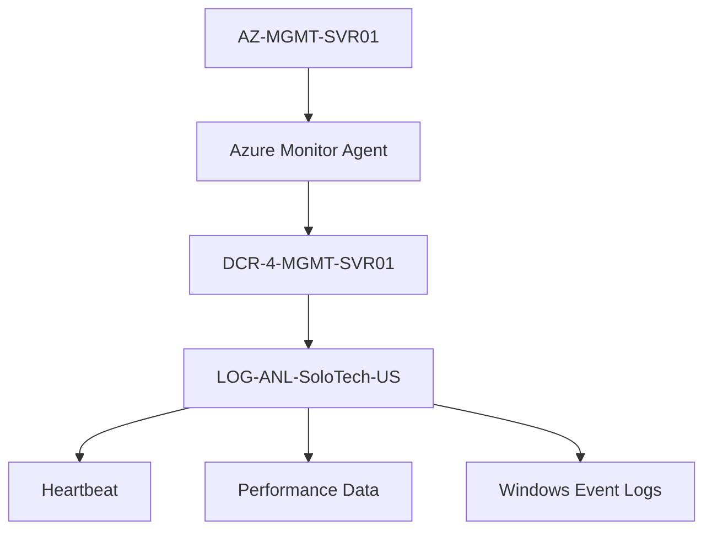

# Azure Monitor & Log Analytics

## Project Objective

Implement centralized monitoring, telemetry collection, and operational visibility for Azure infrastructure.

---

# Components Deployed

## Log Analytics Workspace

```text
LOG-ANL-SoloTech-US
```

Purpose:

Centralized log collection and analysis.

---

## Azure Monitor Workspace

```text
AZ-MNT-SoloTech-US
```

Purpose:

Metrics collection and observability.

---

## Azure Monitor Agent

Installed on:

```text
AZ-MGMT-SVR01
```

Purpose:

Collect logs and performance telemetry.

---

# Initial Challenge

The Azure Monitor Agent deployed successfully.

However:

```kusto
Heartbeat
| take 10
```

returned:

```text
No Results
```

---

# Investigation Activities

Reviewed:

- Azure Monitor Agent
- Data Collection Rule
- Data Collection Endpoint
- Azure Monitor Workspace
- Log Analytics Workspace
- Data Flows
- Resource Associations

---

# Discovery

Monitoring was configured for:

```text
Metrics Collection Only
```

The original DCR contained:

```text
Prometheus Metrics

OpenTelemetry Metrics
```

without a Log Analytics destination.

---

# Root Cause

Missing:

```text
Log Analytics Workspace Destination
```

for:

```text
Heartbeat
Event Logs
Performance Logs
```

---

# Resolution

Created:

```text
DCR-4-MGMT-SVR01
```

Associated Resource:

```text
AZ-MGMT-SVR01
```

---

# Data Sources

## Windows Event Logs

Collected:

```text
Application
System
Security
```

Levels:

```text
Critical
Error
Warning
Information
```

---

## Performance Counters

Collected:

```text
Processor
Memory
Logical Disk
Network Interface
System
```

Destination:

```text
LOG-ANL-SoloTech-US
```

---

# Monitoring Architecture


---

# Validation

## Heartbeat Query

```kusto
Heartbeat
| take 1000
```

Results returned successfully.

Validated:

```text
AZ-MGMT-SVR01
Azure Monitor Agent
OS Details
Heartbeat Status
```

---

## Performance Query

```kusto
Perf
| take 100
```

Returned:

- CPU Usage
- System Uptime
- Disk Operations
- Thread Counts
- Process Statistics

---

# Key Lessons Learned

## Critical Discovery

```text
Azure Monitor Workspace
≠
Log Analytics Workspace
```

Azure Monitor Workspace handles:

```text
Metrics
Observability
OpenTelemetry
```

Log Analytics Workspace handles:

```text
Logs
KQL Queries
Operational Analysis
```

---

# Troubleshooting Methodology


---

# Skills Demonstrated

- Azure Monitor
- Azure Monitor Agent
- Azure Monitor Workspace
- Log Analytics Workspace
- Data Collection Rules
- Kusto Query Language
- Monitoring Troubleshooting
- Event Collection
- Performance Analysis
- Operational Monitoring

---

# Outcome

Successfully implemented Azure monitoring with:

✅ Azure Monitor Agent

✅ Log Analytics Workspace

✅ Data Collection Rules

✅ Windows Event Logs

✅ Performance Counters

✅ Working Heartbeat Monitoring

✅ KQL Query Validation
