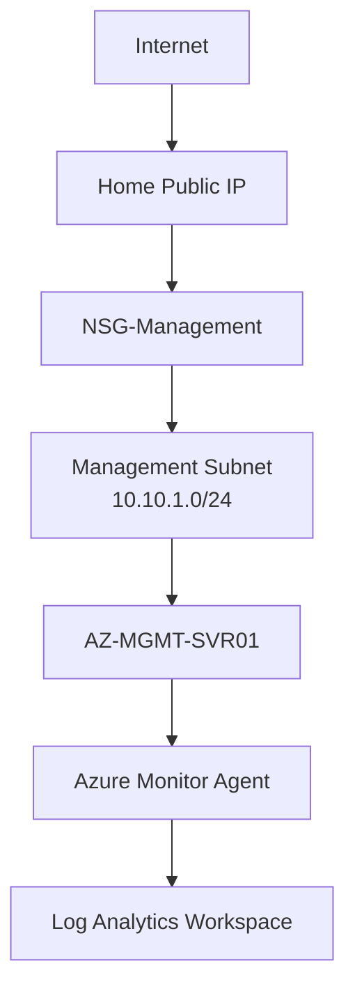

# Azure Security & Governance

## Project Objective

Implement foundational Azure security controls and governance best practices to secure infrastructure resources, protect administrative access, and establish operational guardrails.

This project focused on:

- Network Security
- Administrative Access Control
- Subscription Governance
- Azure Security Features
- Secure Infrastructure Design
- Operational Risk Reduction

---

# Security Architecture Overview



---

# Security Principles Applied

The environment was designed around several core security principles:

### Least Privilege

Only allow the access required.

Example:

```text
Allow RDP only from a trusted IP address
```

instead of:

```text
Allow RDP from Any
```

---

### Network Segmentation

Administrative systems separated from future workloads.

Benefits:

- Reduced attack surface
- Easier investigations
- Better access control
- Improved compliance

---

### Defense in Depth

Security was implemented in multiple layers:

```text
Azure Subscription
        ↓
Virtual Network
        ↓
Subnet Segmentation
        ↓
Network Security Groups
        ↓
Trusted Launch
        ↓
Operating System Security
```

---

# Azure Subscription Governance

## Subscription Review

The initial environment contained multiple subscriptions.

Review activities:

```text
Subscription Validation
Billing Review
Resource Ownership Validation
Cost Centre Identification
```

---

## Governance Outcome

Workloads were standardised into:

```text
Azure Subscription 2 Free Plan
```

Benefits:

- Consistent governance
- Cost visibility
- Simplified administration

---

# Resource Tagging Governance

Standard tags were applied.

| Tag | Value |
|----------|----------|
| Environment | LAB |
| Owner | SoloTech |

---

## Benefits

Tags enable:

```text
Cost Tracking
Ownership Tracking
Resource Discovery
Governance Reporting
Automation
```

---

# Network Security

## Management Network

Subnet:

```text
Management
10.10.1.0/24
```

Purpose:

Administrative workloads.

Hosted Resource:

```text
AZ-MGMT-SVR01
```

---

## NSG-Management

Created:

```text
NSG-Management
```

Purpose:

Protect administrative infrastructure.

---

## RDP Security

### Initial Approach

During planning:

```text
Source = Any
Port = 3389
```

was considered.

---

### Final Secure Design

Implemented:

```text
Source = Home Public IP

Port = 3389

Protocol = TCP

Action = Allow
```

Result:

Only authorised administration endpoints can access:

```text
AZ-MGMT-SVR01
```

---

# Security Flow

```mermaid
flowchart LR

Internet

--> Trusted Home IP

--> NSG-Management

--> AZ-MGMT-SVR01
```

---

# NSG-Servers

Created:

```text
NSG-Servers-US
```

Purpose:

Protect future infrastructure workloads.

---

## Rules Implemented

### RDP

```text
TCP 3389
```

---

### HTTPS

```text
TCP 443
```

---

### Default Protection

Azure automatically enforces:

```text
AllowVnetInBound

AllowAzureLoadBalancerInBound

DenyAllInBound
```

---

# Trusted Launch Security

A Trusted Launch VM was selected during deployment.

---

## Features Enabled

### Secure Boot

Enabled

Purpose:

Prevent boot-level malware and rootkits.

---

### Virtual TPM (vTPM)

Enabled

Purpose:

Provide:

```text
Hardware-backed trust
Boot verification
Credential protection
```

---

# Security Architecture

```mermaid
flowchart TB

VM

--> Trusted Launch

Trusted Launch

--> Secure Boot

Trusted Launch

--> vTPM

Secure Boot

--> Operating System

vTPM

--> Identity Protection
```

---

# Azure VM Hardening

## Network Category

Changed from:

```text
Public
```

to:

```text
Private
```

using:

```powershell
Set-NetConnectionProfile
```

---

## Benefits

Supports:

```text
Remote Administration
Monitoring
PowerShell Remoting
Management Services
```

while maintaining controlled access.

---

# IE Enhanced Security Configuration

Configured:

```text
Administrators = Off

Users = On
```

---

## Reason

Allows administrators to:

- Download management tools
- Access Microsoft documentation
- Manage Azure resources

without unnecessary restrictions.

---

# Identity & Authentication

## Azure CLI Authentication

Configured:

```powershell
az login
```

---

## Azure PowerShell Authentication

Configured:

```powershell
Connect-AzAccount
```

---

## Benefits

Secure authentication through:

```text
Microsoft Entra ID
```

without embedded credentials in scripts.

---

# Managed Identity

Enabled:

```text
System Assigned Managed Identity
```

on:

```text
AZ-MGMT-SVR01
```

---

## Purpose

Provides:

```text
Passwordless Authentication
Azure Service Access
Managed Credentials
```

for future projects.

---

# Monitoring Security

## Azure Monitor Agent

Installed:

```text
Azure Monitor Agent (AMA)
```

Purpose:

Continuous telemetry collection.

---

## Data Collection Rules

Created:

```text
DCR-4-MGMT-SVR01
```

---

## Collected Data

### Windows Event Logs

```text
Application
System
Security
```

---

### Performance Counters

```text
CPU
Memory
Disk
Network
System Uptime
```

---

# Security Monitoring Architecture

```mermaid
flowchart TB

AZ-MGMT-SVR01

-->

Azure Monitor Agent

-->

DCR-4-MGMT-SVR01

-->

LOG-ANL-SoloTech-US

LOG-ANL-SoloTech-US

--> Security Events

--> Performance Data

--> Heartbeat Monitoring
```

---

# Operational Security Controls

## Auto-Shutdown

Configured:

```text
07:00 Daily
```

Purpose:

- Prevent unnecessary costs
- Reduce unattended exposure
- Improve operational discipline

---

## VM Deallocation

Procedure adopted:

```text
Stop (Deallocate)
```

instead of:

```text
Shutdown Only
```

---

## Benefits

```text
Cost Reduction
Resource Governance
Operational Control
```

---

# Security Challenges Encountered

## Multiple Subscriptions

Issue:

Resources initially deployed into an incorrect subscription.

---

## Resolution

Validated:

```text
Subscription
Billing Scope
Credits
Regions
```

before future deployments.

---

## Monitoring Configuration

Issue:

Heartbeat data initially unavailable.

---

## Root Cause

Log Analytics destination not configured.

---

## Resolution

Implemented:

```text
Custom Data Collection Rule
```

with:

```text
Windows Events

Performance Counters

Log Analytics Destination
```

---

# Lessons Learned

## Azure Monitor Workspace

is not the same as:

```text
Log Analytics Workspace
```

Both fulfil different functions within Azure monitoring.

---

## Network Security Groups

Restricting RDP to a trusted source significantly reduces attack exposure.

---

## Subscription Validation

Subscription verification should occur before any workload deployment.

---

## Governance First

Cost management and governance should be implemented before:

```text
Virtual Machines
Storage
Monitoring
Backup Services
```

---

# Security Skills Demonstrated

## Azure Governance

- Subscription Management
- Resource Tagging
- Budget Controls
- Cost Governance

---

## Azure Network Security

- Network Security Groups
- Subnet Segmentation
- Administrative Access Control
- Least Privilege Design

---

## Azure Compute Security

- Trusted Launch
- Secure Boot
- vTPM
- Azure VM Hardening

---

## Identity Security

- Azure CLI Authentication
- Azure PowerShell Authentication
- Managed Identities

---

## Security Monitoring

- Azure Monitor Agent
- Data Collection Rules
- Event Log Collection
- Heartbeat Monitoring
- Operational Visibility

---

# Project Outcome

Successfully implemented:

✅ Subscription Governance

✅ Security Tagging

✅ Network Segmentation

✅ Restricted RDP Access

✅ Trusted Launch Security

✅ Secure Boot

✅ vTPM

✅ Managed Identity

✅ Azure Monitor Agent

✅ Security Event Collection

✅ Operational Monitoring

✅ Governance Controls

The resulting environment provides a secure and governed foundation for future Azure projects including Azure Backup, RBAC, Microsoft Defender for Cloud, Key Vault, Conditional Access, and Azure Identity Governance.
