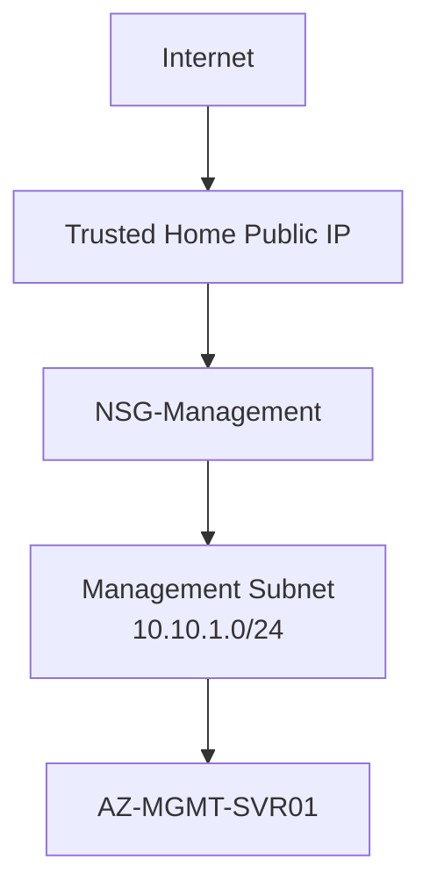
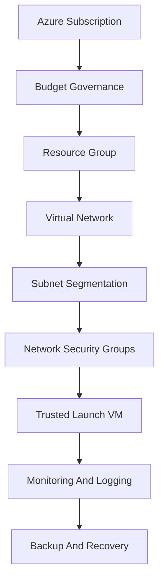
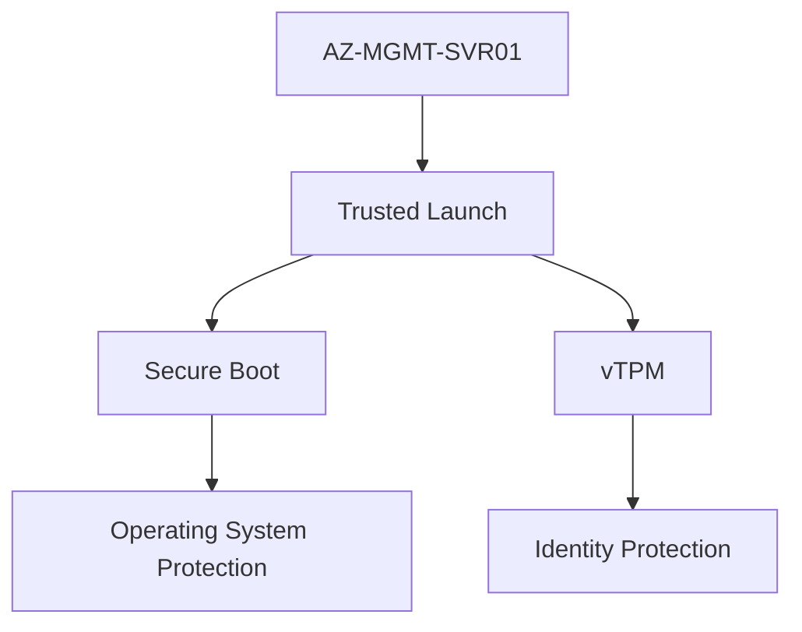
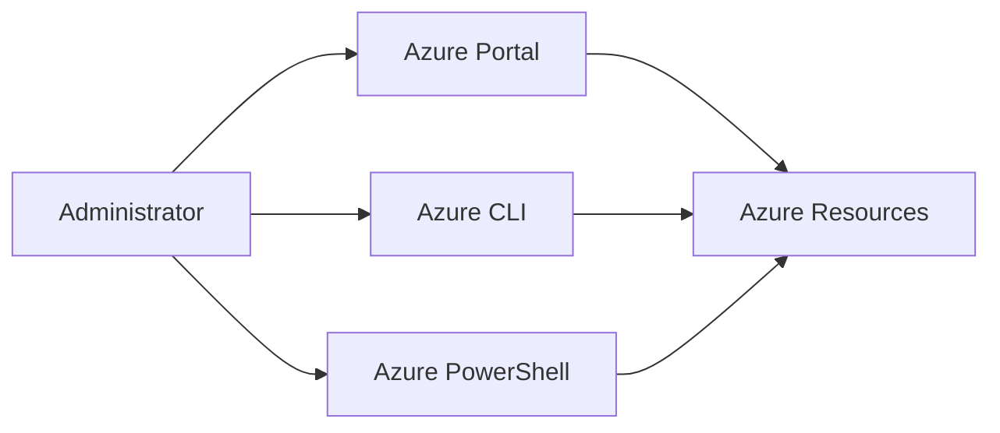
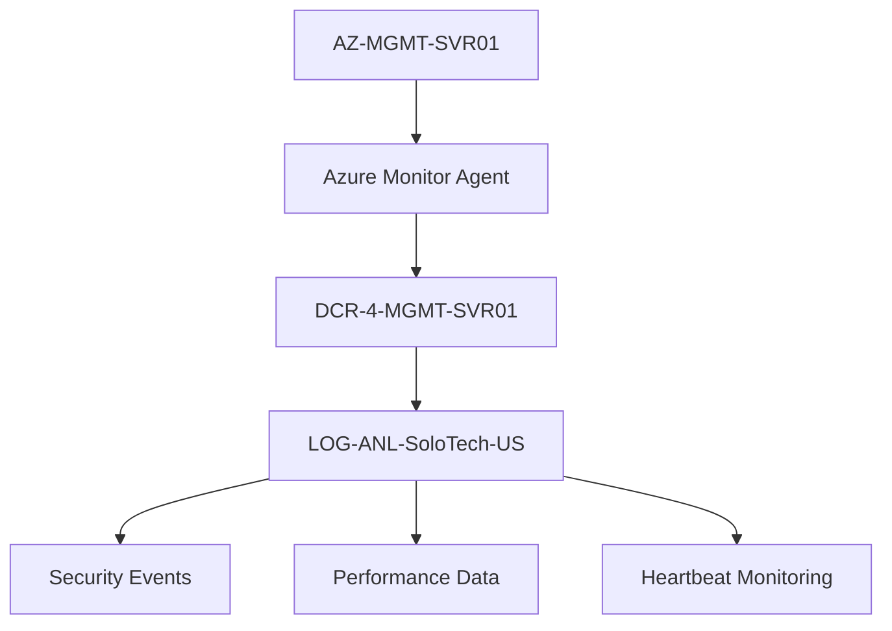

# Azure Security & Governance

## Project Overview

This project focused on implementing foundational Azure security controls and governance best practices to secure infrastructure resources, protect administrative access, and establish operational guardrails.

Security was integrated throughout the deployment lifecycle, beginning with subscription governance and extending through network security, virtual machine hardening, identity protection, monitoring, and operational controls.

---

# Project Objectives

The objectives of this phase were to:

- Implement Azure governance controls
- Secure infrastructure resources
- Protect administrative access
- Reduce attack surface exposure
- Implement monitoring and visibility
- Apply security best practices
- Establish operational safeguards

---

# Security Architecture Overview



---

# Security Principles Applied

The environment was designed using several core security principles.

## Least Privilege

Only the minimum permissions and access required were granted.

Example:

```text
Allow RDP From Home Public IP
```

instead of:

```text
Allow RDP From Any Source
```

---

## Network Segmentation

Infrastructure was separated into dedicated subnets.

Benefits:

- Reduced attack surface
- Clear workload separation
- Simpler access control
- Easier monitoring and troubleshooting

---

## Defense In Depth

Multiple security layers were implemented.



---

# Subscription Governance

## Subscription Review

During deployment two Azure subscriptions were discovered.

Resources were initially created in the incorrect subscription and later migrated into the Azure Free Plan subscription.

---

## Governance Controls

Validated before deployment:

```text
Subscription
Billing Scope
Region
Credits
Resource Ownership
```

---

## Outcome

Infrastructure standardised within:

```text
Azure Subscription 2 Free Plan
```

Benefits:

- Centralised billing
- Simplified governance
- Better cost visibility
- Reduced operational complexity

---

# Resource Tagging

Standard governance tags were implemented:

| Tag | Value |
|----------|----------|
| Environment | LAB |
| Owner | SoloTech |

Benefits:

- Cost Management
- Resource Discovery
- Ownership Tracking
- Governance Reporting

---

# Network Security

## Management Network

Subnet:

```text
Management
10.10.1.0/24
```

Protected Resource:

```text
AZ-MGMT-SVR01
```

---

## NSG-Management

Created:

```text
NSG-Management
```

Purpose:

Protect administrative infrastructure.

### Administrative Access Flow


---

### Rule Configuration

#### Allow RDP

```text
TCP 3389
```

Source:

```text
Home Public IP Address
```

Action:

```text
Allow
```

---

### Default Azure Protection

```text
AllowVnetInBound

AllowAzureLoadBalancerInBound

DenyAllInBound
```

---

# Infrastructure Security

## NSG-Servers

Created:

```text
NSG-Servers-US
```

Purpose:

Protect future application and infrastructure workloads.

---

## Rules Implemented

### RDP

```text
TCP 3389
```

### HTTPS

```text
TCP 443
```

---

# Trusted Launch Security

The management server was deployed using:

```text
Trusted Launch Virtual Machine
```

---

## Enabled Features

### Secure Boot

Enabled

Purpose:

```text
Block bootkits
Block rootkits
Protect OS startup process
```

---

### Virtual Trusted Platform Module

Enabled

Purpose:

```text
Hardware-backed trust
Credential protection
Secure boot validation
```

---

## Trusted Launch Architecture



---

# VM Hardening

## Network Profile

Changed from:

```text
Public
```

to:

```text
Private
```

Using:

```powershell
Set-NetConnectionProfile
```

Benefits:

- Easier administration
- Better remote management
- Supports future PowerShell remoting

---

## IE Enhanced Security

Configured:

```text
Administrators = Off

Users = On
```

Purpose:

Allow administrative access to Microsoft downloads and tools while maintaining protection for standard users.

---

# Identity & Authentication

## Azure CLI Authentication

Configured:

```powershell
az login
```

Purpose:

Authenticate securely to Azure services using Microsoft Entra ID.

---

## Azure PowerShell Authentication

Configured:

```powershell
Connect-AzAccount
```

Purpose:

PowerShell-based administration of Azure resources.

---

# Azure Administration Model



---

# Managed Identity

Enabled:

```text
System Assigned Managed Identity
```

on:

```text
AZ-MGMT-SVR01
```

Benefits:

- Passwordless authentication
- Azure service integration
- Improved security posture

---

# Security Monitoring

## Azure Monitor Agent

Installed:

```text
Azure Monitor Agent
```

Purpose:

Collect operational and security telemetry.

---

## Data Collection Rules

Created:

```text
DCR-4-MGMT-SVR01
```

---

## Collected Data

### Windows Events

```text
Application

System

Security
```

---

### Performance Counters

```text
CPU

Memory

Disk

Network

System Uptime
```

---

# Monitoring Architecture



---

# Operational Security Controls

## Auto Shutdown

Configured:

```text
07:00 Daily
```

Purpose:

- Cost Reduction
- Resource Governance
- Reduced Risk Exposure

---

## VM Deallocation

Adopted operational process:

```text
Stop (Deallocate)
```

instead of:

```text
Shutdown Only
```

Benefits:

```text
Reduced costs

Improved governance

Operational discipline
```

---

# Security Challenges Encountered

## Subscription Governance Issue

Challenge:

Infrastructure initially deployed into the wrong subscription.

Resolution:

Validated:

```text
Billing Scope

Subscription Ownership

Credit Availability

Resource Placement
```

before continuing deployment.

---

## Monitoring Configuration Issue

Challenge:

Azure Monitor Agent deployed successfully but logging was not functioning.

Symptoms:

```kusto
Heartbeat
| take 10
```

returned no results.

---

## Root Cause

Original monitoring configuration collected metrics only.

Missing:

```text
Log Analytics Workspace Destination
```

---

## Resolution

Created:

```text
DCR-4-MGMT-SVR01
```

Configured:

```text
Windows Event Logs

Performance Counters

Log Analytics Workspace
```

Verified using:

```kusto
Heartbeat

Perf

Event
```

queries.

---

# Lessons Learned

## Subscription Validation

Always validate:

```text
Subscription

Billing Scope

Region

Credits
```

before deploying workloads.

---

## Azure Monitor Workspace

Critical learning:

```text
Azure Monitor Workspace
≠
Log Analytics Workspace
```

Each serves a different purpose within Azure monitoring.

---

## Network Security

Restricting administrative access to known IP addresses significantly reduces attack exposure.

---

## Governance First

Budgeting, tagging, and governance should be implemented before deploying infrastructure.

---

# Skills Demonstrated

## Governance

- Budget Controls
- Resource Tagging
- Subscription Governance
- Cost Management

---

## Network Security

- Network Security Groups
- Subnet Segmentation
- Access Restrictions
- Least Privilege Design

---

## Azure Security

- Trusted Launch
- Secure Boot
- vTPM
- VM Hardening

---

## Identity

- Managed Identity
- Azure CLI Authentication
- Azure PowerShell Authentication

---

## Security Monitoring

- Azure Monitor Agent
- Log Analytics Workspace
- Data Collection Rules
- Windows Event Collection
- Performance Monitoring
- KQL Validation

---

# Project Outcome

Successfully implemented:

✅ Subscription Governance

✅ Resource Tagging

✅ Network Segmentation

✅ Restricted Administrative Access

✅ Trusted Launch Security

✅ Secure Boot

✅ vTPM

✅ Managed Identity

✅ Azure Monitor Agent

✅ Event Collection

✅ Security Monitoring

✅ Governance Controls

The resulting environment provides a secure and governed foundation for future Azure projects including Backup & Recovery, Azure RBAC, Defender for Cloud, Key Vault, Storage Accounts, and Identity Governance.
