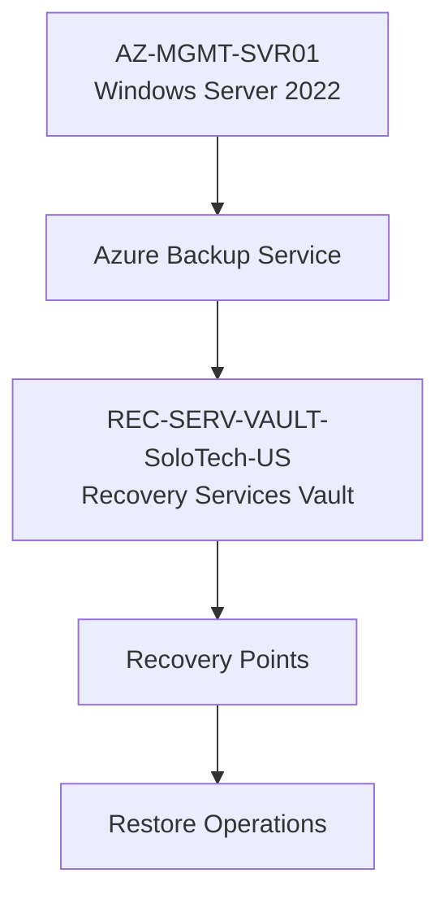
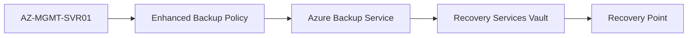
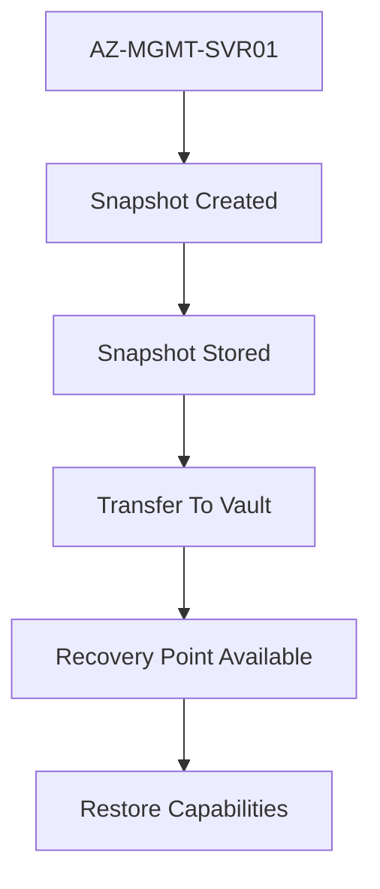
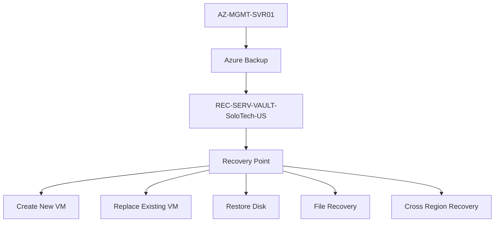

# Azure Backup & Recovery Services Vault Project

## Project Overview

This project focused on implementing Azure Backup and Recovery capabilities for Azure virtual machines using Azure Recovery Services Vault. The goal was to establish a business continuity and disaster recovery foundation for Azure infrastructure workloads.

The implementation included:

- Recovery Services Vault deployment
- Backup policy configuration
- Azure VM protection
- Recovery point creation
- Backup validation
- Restore operation analysis
- Business continuity planning

---

# Project Objectives

The objectives of this project were to:

- Protect Azure virtual machines from accidental loss or corruption
- Implement centralized backup management
- Create recovery points for virtual machine restoration
- Learn Azure Backup architecture
- Understand restore workflows
- Build practical business continuity and disaster recovery skills

---

# Environment Information

| Component | Value |
|------------|------------|
| Subscription | Azure Subscription 2 Free Plan |
| Resource Group | RG-Management-US |
| Region | North Central US |
| Recovery Services Vault | REC-SERV-VAULT-SoloTech-US |
| Protected VM | AZ-MGMT-SVR01 |
| Backup Policy | Enhanced Policy |
| Storage Redundancy | Geo-Redundant Storage (GRS) |

---

# Recovery Services Vault Deployment

## Recovery Services Vault

Created:

```text
REC-SERV-VAULT-SoloTech-US
```

Purpose:

```text
Centralized backup and recovery platform
for Azure workloads.
```

Region:

```text
North Central US
```

Resource Group:

```text
RG-Management-US
```

---

# Backup Vault Architecture



---

# Vault Configuration

## Backup Storage Redundancy

Configured:

```text
Geo-Redundant Storage (GRS)
```

Purpose:

```text
Maintain a secondary copy
of backup data in a paired region.
```

Benefits:

- Increased resilience
- Regional disaster protection
- Improved business continuity

---

## Immutability

Enabled during deployment.

Purpose:

```text
Protect recovery points from:
- Accidental deletion
- Malicious deletion
- Ransomware activity
```

Benefits:

- Enhanced vault security
- Improved recovery assurance
- Backup tamper protection

---

## Managed Identity

System Assigned Managed Identity enabled.

Benefits:

- Passwordless authentication
- Integration with Azure security services
- Future automation capabilities

---

# Azure VM Protection

Protected Virtual Machine:

```text
AZ-MGMT-SVR01
```

Virtual Machine Details:

| Setting | Value |
|----------|----------|
| VM Name | AZ-MGMT-SVR01 |
| Role | Azure Management Server |
| Region | North Central US |
| Operating System | Windows Server 2022 Azure Edition |
| Security | Trusted Launch |
| Secure Boot | Enabled |
| vTPM | Enabled |

---

# Backup Policy Configuration

Policy Type:

```text
Enhanced Policy
```

---

## Backup Frequency

Configured:

```text
Every 4 Hours
```

Purpose:

Provide multiple recovery opportunities throughout the day.

---

## Instant Restore

Retention:

```text
2 Days
```

Purpose:

Enable rapid restoration from local snapshots before vault retrieval is required.

---

## Recovery Point Retention

Retention:

```text
30 Days
```

Benefits:

- Historical recovery capability
- Operational recovery flexibility
- Protection against delayed issues

---

# Backup Workflow



---

# Initial Backup Execution

A manual backup was initiated to validate the protection configuration.

Backup Status:

```text
Successful
```

Backup Size:

```text
16,442 MB
```

Backup Duration:

```text
Approximately 27 Minutes
```

---

# Backup Job Stages

## Stage 1

### Snapshot Creation

Status:

```text
Completed
```

Duration:

```text
00:08:12
```

Purpose:

Capture a recovery snapshot of the virtual machine.

---

## Stage 2

### Transfer Data To Vault

Status:

```text
Completed
```

Duration:

```text
00:18:01
```

Purpose:

Transfer backup data into protected vault storage.

---

## Stage 3

### Backup Validation

Status:

```text
Completed
```

Duration:

```text
00:00:30
```

Purpose:

Verify backup integrity and recovery readiness.

---

# Recovery Point Creation

The first recovery point was successfully created.

Recovery Point Type:

```text
Crash Consistent
```

Protection Status:

```text
Immutable
```

Storage Type:

```text
Snapshot + Vault Standard
```

---

# Recovery Point Lifecycle



---

# Restore Operations

Azure Backup provides multiple restoration methods.

---

## Option 1 - Create New Virtual Machine

Recommended for:

- Testing
- Investigation
- Validation
- Recovery verification

Workflow:


Benefits:

- Production VM remains untouched
- Safe recovery testing
- Minimal operational risk

---

## Option 2 - Replace Existing VM

Recommended when:

```text
Current VM is no longer recoverable.
```

Benefits:

- Fast rollback
- Recovery from corruption
- Operating system recovery

Risks:

- Overwrites existing instance
- Removes current state

---

## Option 3 - Restore Disks

Purpose:

Recover only the virtual disks without restoring the entire virtual machine.

Typical Use Cases:

- File extraction
- Disk corruption
- Targeted data recovery

Workflow:


---

## Option 4 - File Recovery

Purpose:

Recover individual files and folders without recovering the full VM.

Benefits:

- Faster recovery
- Reduced operational impact
- Targeted restoration

---

## Option 5 - Cross-Region Recovery

Supported through:

```text
Geo-Redundant Storage (GRS)
```

Purpose:

Recover workloads in the event of a regional outage.

Workflow:


---

# Business Continuity Architecture



---

# Lessons Learned

## Recovery Services Vault

Recovery Services Vault acts as the centralized backup repository for Azure Backup and Azure recovery services.

---

## Enhanced Policies

Enhanced backup policies provide:

- Multiple backups per day
- Instant Restore
- Trusted Launch compatibility
- Improved retention capabilities

---

## Recovery Points

A protected VM is not considered recoverable until a valid recovery point exists.

Protection alone does not guarantee recovery.

---

## Immutable Backups

Immutable recovery points significantly improve resilience against accidental deletion and malicious activity.

---

## Backup vs Disaster Recovery

### Backup

Protects:

```text
Files
Operating System
VM State
```

Recovery Time:

```text
Minutes to Hours
```

---

### Disaster Recovery

Protects:

```text
Entire Workloads
Services
Regional Failures
```

Recovery Time:

```text
Near Real-Time
```

---

# Skills Demonstrated

## Azure Backup

- Recovery Services Vault
- Azure VM Backup
- Backup Policies
- Recovery Point Management

## Business Continuity

- Workload Protection
- Recovery Planning
- Data Protection
- Recovery Validation

## Disaster Recovery

- Geo-Redundant Storage
- Recovery Workflows
- Restore Operations
- Business Continuity Planning

## Azure Administration

- Backup Job Monitoring
- Recovery Services Management
- Recovery Point Validation
- Restore Scenario Analysis

---

# Project Outcome

Successfully implemented Azure Backup and Recovery Services for:

```text
AZ-MGMT-SVR01
```

Achievements:

✅ Recovery Services Vault Deployment

✅ Geo-Redundant Storage

✅ Enhanced Backup Policy

✅ Protected Azure VM

✅ Immutable Recovery Points

✅ Successful Backup Execution

✅ Backup Validation

✅ Recovery Point Creation

✅ Restore Workflow Analysis

✅ Business Continuity Planning

This project established a foundational Azure Backup and Recovery platform capable of protecting infrastructure workloads and supporting future disaster recovery initiatives within the Azure Infrastructure & Operations Lab.
