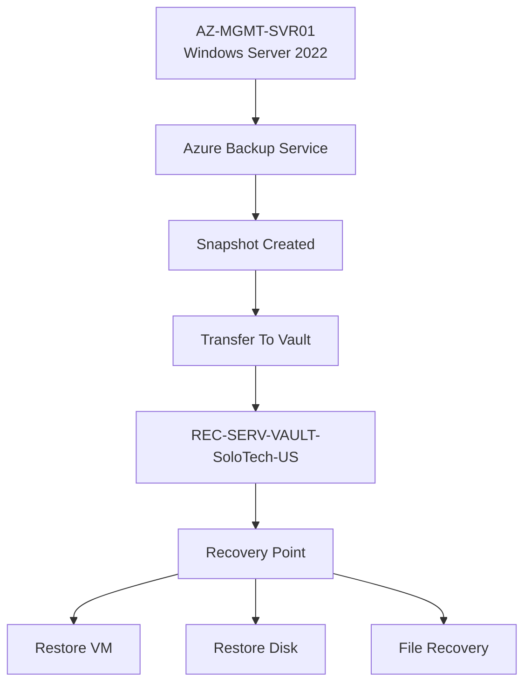
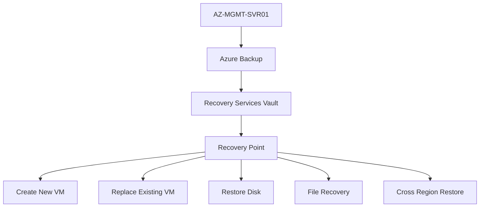

## Azure Backup & Recovery

### Components

- Recovery Services Vault: REC-SERV-VAULT-SoloTech-US
- Protected Resource: AZ-MGMT-SVR01
- Policy Type: Enhanced Backup Policy
- Recovery Point Type: Crash Consistent Snapshot

### Backup Features

- Enhanced Policy
- Instant Restore Capability
- Immutable Recovery Points
- 30-Day Retention
- Geo-Redundant Vault Storage

### Skills Demonstrated

- Azure Backup
- Recovery Services Vault
- Recovery Point Management
- Backup Policies
- Business Continuity
- Infrastructure Protection

# Azure Backup Architecture

## Azure Backup Lifecycle

