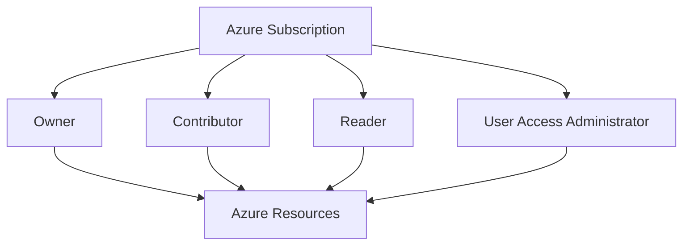
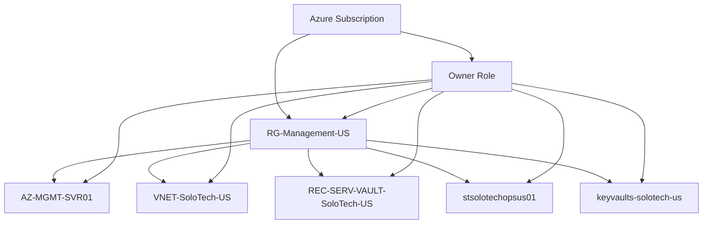

# Azure Role-Based Access Control (RBAC)

## Project Overview

This project focused on implementing and understanding Azure Role-Based Access Control (RBAC) within the Azure Enterprise Infrastructure Lab.

The objective was to understand how Azure controls access to resources through role assignments, permission inheritance, security boundaries, and the principle of least privilege.

This project forms the foundation for secure administration of all deployed Azure resources including:

- Azure Virtual Machines
- Recovery Services Vaults
- Storage Accounts
- Azure Key Vault
- Log Analytics Workspaces
- Azure Monitor
- Networking Components

---

# Project Objectives

The objectives of this project were to:

- Understand Azure RBAC concepts
- Review inherited permissions
- Examine Azure IAM capabilities
- Understand assignment scopes
- Explore built-in Azure roles
- Understand least privilege principles
- Implement Key Vault RBAC permissions
- Prepare for Managed Identity integration

---

# What is Azure RBAC?

Azure Role-Based Access Control (RBAC) is Microsoft's authorization system used to control access to Azure resources.

RBAC determines:

```text
Who can access resources

What actions they can perform

Where permissions apply
```

---

# RBAC Architecture



---

# Azure RBAC Components

RBAC consists of:

## Security Principal

Represents:

```text
User

Group

Service Principal

Managed Identity
```

---

## Role Definition

Defines:

```text
Permissions
```

Examples:

```text
Owner

Contributor

Reader

Key Vault Administrator
```

---

## Scope

Defines where the role applies.

Azure scopes:

```text
Management Group

Subscription

Resource Group

Individual Resource
```

---

## Role Assignment

Combines:

```text
Principal
+
Role
+
Scope
```

---

# Reviewing Existing Permissions

The Azure environment was reviewed using:

```text
Access Control (IAM)
```

located within:

```text
RG-Management-US
```

---

# Current Administrative Account

Administrative account:

```text
Solo Gates (Admin)
```

Role Assignment:

```text
Owner
```

Assignment Type:

```text
Inherited
```

Assignment Scope:

```text
Azure Subscription 2 Free Plan
```

---

# RBAC Inheritance

One of the key concepts discovered during this project was permission inheritance.

The Owner role assigned at the Subscription level automatically flowed down to all child resources.

---

# Permission Inheritance Model



---

# Role Review

## Owner

Permissions:

```text
Full Resource Management

Role Assignment Management

Resource Deletion

Resource Creation
```

Can Assign Roles:

```text
Yes
```

---

## Contributor

Permissions:

```text
Manage Resources

Create Resources

Delete Resources
```

Cannot:

```text
Assign RBAC Roles
```

Can Assign Roles:

```text
No
```

---

## Reader

Permissions:

```text
View Resources

View Configuration
```

Cannot:

```text
Modify Resources

Create Resources

Delete Resources
```

Can Assign Roles:

```text
No
```

---

## User Access Administrator

Permissions:

```text
Manage Role Assignments
```

Cannot:

```text
Create Resources

Modify Resources
```

Can Assign Roles:

```text
Yes
```

---

# Built-In Roles Comparison

| Role | View Resources | Manage Resources | Assign Roles |
|----------|----------|----------|----------|
| Reader | ✅ | ❌ | ❌ |
| Contributor | ✅ | ✅ | ❌ |
| Owner | ✅ | ✅ | ✅ |
| User Access Administrator | ✅ | ❌ | ✅ |

---

# Least Privilege Principle

One of the primary concepts explored was:

```text
Least Privilege
```

Definition:

Provide only the permissions required to perform a task.

Avoid:

```text
Everyone = Owner
```

Preferred:

```text
Reader

Contributor

Resource-Specific Roles
```

where appropriate.

---

# Azure Key Vault RBAC

When Azure Key Vault was deployed, the vault was configured using:

```text
Azure RBAC Permission Model
```

instead of:

```text
Vault Access Policies
```

---

# Key Vault Authorization Model


---

# RBAC Challenge Encountered

Following deployment of:

```text
keyvaults-solotech-us
```

PowerShell access failed.

Command:

```powershell
Get-AzKeyVaultSecret
```

Returned:

```text
Forbidden
```

Despite:

```text
Owner Role Assigned
```

---

# Investigation

Review of the Azure RBAC model identified an important distinction.

Owner role provided:

```text
Management Plane Access
```

but not:

```text
Key Vault Data Plane Access
```

---

# Root Cause

The Owner role allowed:

```text
Create Vault

Delete Vault

Configure Settings
```

but not necessarily:

```text
Read Secrets

Create Secrets

Delete Secrets
```

when using:

```text
Azure RBAC Authorization
```

---

# Resolution

Assigned:

```text
Key Vault Administrator
```

Role

Scope:

```text
keyvaults-solotech-us
```

Principal:

```text
Solo Gates (Admin)
```

---

# Updated Access Model


---

# Validation

After RBAC propagation completed:

```powershell
Get-AzKeyVaultSecret
```

returned successfully.

Secret successfully retrieved:

```text
StorageAccountKey
```

confirming:

✅ RBAC functioning

✅ Data Plane Access operational

✅ Key Vault Authorization successful

---

# Security Benefits of Azure RBAC

Azure RBAC provides:

- Centralized authorization
- Granular access control
- Auditable permissions
- Least privilege implementation
- Separation of duties
- Consistent identity management

---

# Skills Demonstrated

## Identity & Access Management

- Azure RBAC
- IAM Review
- Permission Inheritance
- Role Assignment Analysis

---

## Security

- Least Privilege
- Role Separation
- Access Governance
- Subscription-Level Authorization

---

## Azure Key Vault Security

- RBAC Authorization Model
- Key Vault Administrator Role
- Secret Access Management
- Data Plane Authorization

---

## Troubleshooting

- Permission Investigation
- RBAC Propagation Analysis
- Authorization Troubleshooting
- Access Validation

---

# Lessons Learned

## Subscription Inheritance

Permissions assigned at the Subscription scope automatically flow down to child resources.

---

## Owner Does Not Always Mean Full Access

When using Azure RBAC with Key Vault:

```text
Owner
```

does not automatically guarantee:

```text
Secret Access
```

Additional data-plane permissions may be required.

---

## RBAC is the Preferred Modern Model

Microsoft recommends:

```text
Azure RBAC
```

for new deployments instead of traditional:

```text
Vault Access Policies
```

---

## Least Privilege Remains Critical

Permissions should be assigned based on operational requirements rather than convenience.

---

# Project Outcome

Successfully implemented and validated Azure Role-Based Access Control across the Azure Enterprise Infrastructure Lab.

Achievements:

✅ Subscription-Level Authorization Review

✅ Permission Inheritance Analysis

✅ Built-In Role Evaluation

✅ IAM Investigation

✅ Key Vault RBAC Implementation

✅ Key Vault Administrator Assignment

✅ Secret Access Validation

✅ RBAC Troubleshooting & Resolution

This project established the authorization foundation used throughout the Azure environment and prepared the platform for future Managed Identity, Automation, Key Vault Integration, and Enterprise Security projects.
