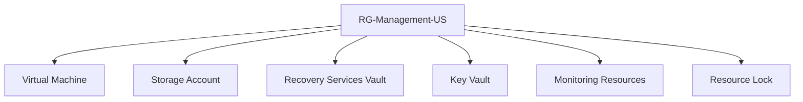
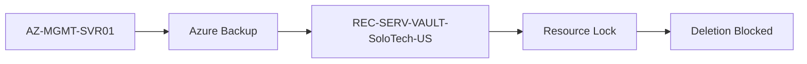
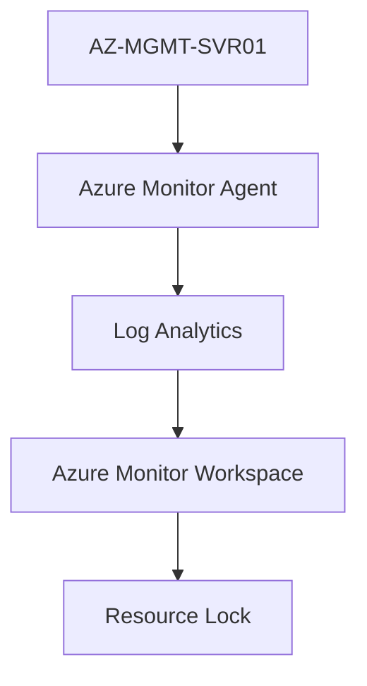
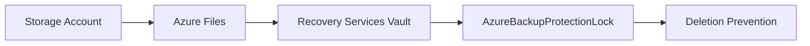
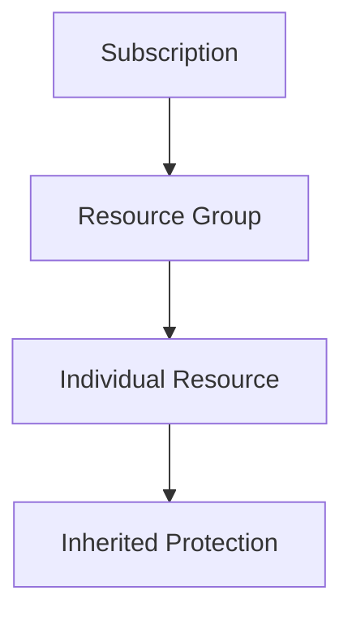
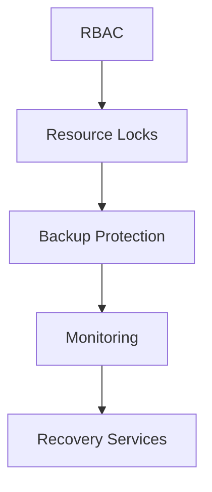

# Azure Resource Locks

## Project Overview

This project focused on implementing Azure Resource Locks to protect critical infrastructure resources from accidental deletion or modification.

As the Azure Enterprise Infrastructure Lab expanded to include monitoring, backups, storage, networking, and security services, governance controls were required to prevent administrative mistakes from impacting business-critical resources.

Azure Resource Locks provide an additional layer of protection beyond Role-Based Access Control (RBAC), ensuring critical resources remain protected even when users have administrative permissions.

---

# Project Objectives

The objectives of this project were to:

- Understand Azure Resource Locks
- Implement governance controls
- Prevent accidental resource deletion
- Protect critical Azure services
- Explore lock inheritance
- Learn resource protection strategies
- Implement enterprise operational safeguards
- Improve platform resilience

---

# What Are Azure Resource Locks?

Azure Resource Locks are governance controls that prevent resources from being accidentally modified or deleted.

Locks are enforced by Azure regardless of a user's administrative permissions.

Even an:

```text
Owner
```

can be prevented from deleting protected resources.

---

# Resource Lock Architecture


---

# Lock Types

Azure provides two lock types.

---

## CanNotDelete

Allows:

✅ Read

✅ Modify

✅ Update

Blocks:

❌ Delete

---

## ReadOnly

Allows:

✅ Read

Blocks:

❌ Modify

❌ Delete

---

# Enterprise Usage

Resource Locks are frequently used to protect:

```text
Production Resource Groups

Backup Infrastructure

Recovery Services Vaults

Key Vaults

Storage Accounts

Domain Controllers

Core Networking Components
```

---

# Initial Environment

Prior to lock implementation the environment contained:

```text
AZ-MGMT-SVR01

REC-SERV-VAULT-SoloTech-US

LOG-ANL-SoloTech-US

Azure Monitor Workspaces

Storage Resources
```

Potential administrative mistakes could result in:

```text
Delete Backup Vault

Delete Monitoring Platform

Delete Storage Resources

Delete Resource Groups
```

---

# Governance Strategy

Resources were reviewed and classified based upon operational importance.

Protected resources included:

```text
RG-Management-US

REC-SERV-VAULT-SoloTech-US

LOG-ANL-SoloTech-US

Azure Monitor Workspaces
```

---

# Resource Group Protection

## Protected Resource

```text
RG-Management-US
```

Lock Type:

```text
CanNotDelete
```

Purpose:

Prevent accidental deletion of the entire infrastructure environment.

---

# Resource Group Architecture



---

# Recovery Services Vault Protection

## Protected Resource

```text
REC-SERV-VAULT-SoloTech-US
```

Lock Type:

```text
CanNotDelete
```

Purpose:

Protect:

```text
Recovery Points

Backup Policies

Backup Configurations

Restore Capabilities
```

from accidental deletion.

---

# Backup Protection Architecture



---

# Monitoring Platform Protection

## Protected Resource

```text
LOG-ANL-SoloTech-US
```

Purpose:

Protect:

```text
Operational Logs

Performance Metrics

Event Data

Monitoring Infrastructure
```

---

# Azure Monitor Workspace Protection

Protected Resources:

```text
AZ-MNT-SoloTech-US

Azure Monitor Workspace Resources
```

Purpose:

Prevent loss of monitoring and telemetry platforms.

---

# Monitoring Protection Architecture



---

# Storage Account Governance Discovery

During later storage administration projects, an unexpected lock was identified.

Lock Name:

```text
AzureBackupProtectionLock
```

---

# Investigation

The lock appeared automatically on:

```text
stsolotechopsus01
```

and blocked resource deletion operations.

Initial assumption:

```text
Manual Lock Created
```

---

# Root Cause Analysis

Investigation revealed:

```text
Azure Backup
```

automatically creates protection locks for storage accounts protected by:

```text
Recovery Services Vault
```

when Azure Files backups are enabled.

---

# Azure Backup Protection Model



---

# Challenge Encountered

Attempting to delete resources generated errors similar to:

```text
Cannot perform delete operation because scope is locked
```

Affected resources:

```text
Azure File Shares

Storage Components

Private Endpoint Cleanup
```

---

# Resolution

Backup configuration was reviewed within:

```text
REC-SERV-VAULT-SoloTech-US
```

Protected file shares were identified.

Backup protection was removed where appropriate.

Following decommissioning:

```text
AzureBackupProtectionLock
```

was automatically removed.

---

# Lessons Learned

Resource deletion should follow:

```text
Backup Review

Dependency Review

Protection Removal

Lock Validation

Resource Deletion
```

rather than simply deleting locks.

---

# Lock Inheritance

Locks can be applied at multiple scopes.

---

# Scope Hierarchy



A lock applied higher in the hierarchy affects all child resources.

---

# Governance Benefits

Resource Locks provide:

- Operational safety
- Protection against human error
- Improved governance
- Enhanced disaster recovery readiness
- Better change control
- Additional defense in depth

---

# Resource Locks Vs RBAC

| Feature | RBAC | Resource Lock |
|----------|----------|----------|
| Controls Access | ✅ | ❌ |
| Prevents Deletion | Limited | ✅ |
| Prevents Modification | Limited | ✅ |
| Supports Least Privilege | ✅ | ❌ |
| Governance Control | ✅ | ✅ |

---

# Security Model

Azure governance follows a layered approach:



Each layer provides additional protection.

---

# Skills Demonstrated

## Governance

- Azure Resource Locks
- Resource Protection
- Governance Controls
- Operational Risk Reduction

---

## Business Continuity

- Backup Protection
- Recovery Services Vault Protection
- Monitoring Platform Protection

---

## Operations

- Dependency Analysis
- Resource Lifecycle Management
- Change Management
- Platform Administration

---

## Troubleshooting

- Lock Investigation
- Scope Analysis
- Azure Backup Protection Locks
- Dependency Resolution

---

# Key Lessons Learned

## Administrative Access Is Not Enough

Even users with:

```text
Owner
```

permissions can be prevented from deleting resources when locks are present.

---

## Azure Backup Creates Protection Locks

Protected storage resources may automatically receive:

```text
AzureBackupProtectionLock
```

to prevent accidental destruction of backup dependencies.

---

## Governance Requires Multiple Layers

Effective governance combines:

```text
RBAC

Resource Locks

Backups

Monitoring

Security Controls
```

rather than relying on a single protection mechanism.

---

# Project Outcome

Successfully implemented Azure Resource Locks throughout the Azure Enterprise Infrastructure Lab.

Achievements:

✅ Resource Group Protection

✅ Recovery Services Vault Protection

✅ Monitoring Platform Protection

✅ Azure Monitor Workspace Protection

✅ Deletion Safeguards

✅ Governance Controls

✅ Azure Backup Protection Lock Investigation

✅ Resource Dependency Analysis

✅ Operational Risk Reduction

This project established a strong governance foundation designed to prevent accidental deletion of critical infrastructure resources while supporting business continuity, recovery operations, and secure Azure administration.
