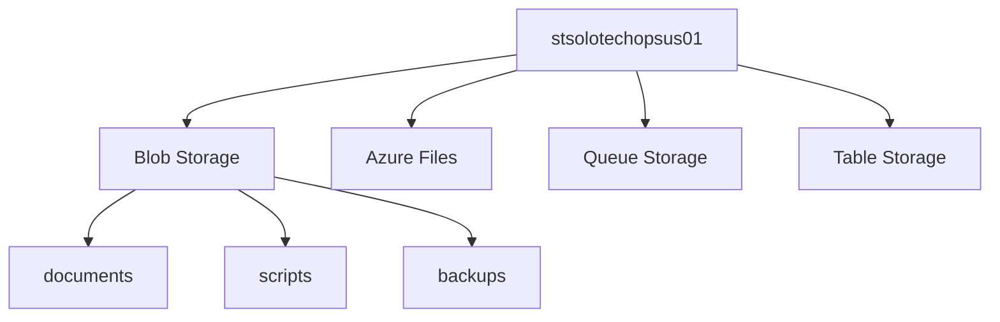
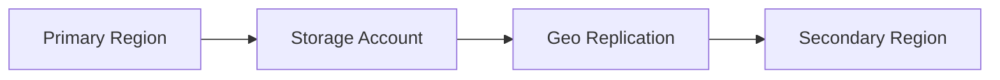
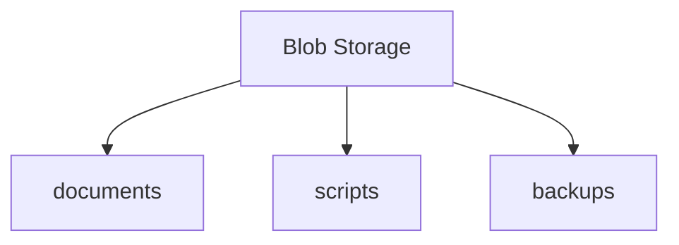
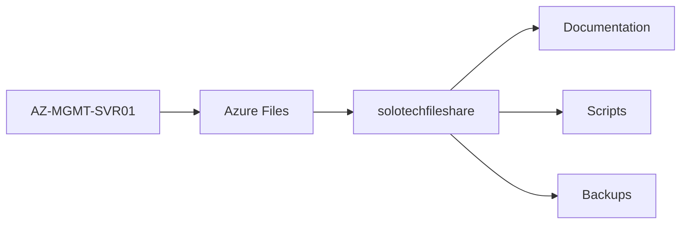
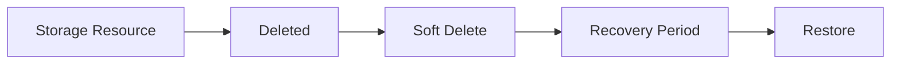
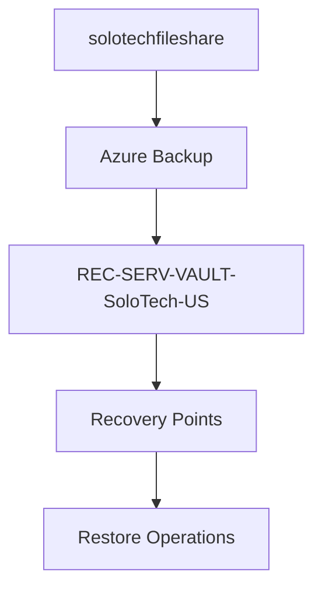

# Azure Storage Platform

## Project Overview

This project focused on designing and implementing a secure Azure Storage platform capable of supporting file storage, object storage, backup workflows, automation solutions, and future cloud-native integrations.

The implementation evolved from a simple Storage Account deployment into an enterprise-style storage architecture featuring:

- Blob Storage
- Azure Files
- Soft Delete Protection
- Geo-Redundant Storage
- Backup Integration
- Private Endpoints
- Private DNS
- Network Isolation

The storage platform serves as the central data repository for documentation, scripts, operational files, backups, and future automation projects.

---

# Project Objectives

The objectives of this project were to:

- Deploy Azure Storage Account
- Implement Blob Storage
- Deploy Azure Files
- Configure storage protection features
- Enable backup integration
- Implement secure storage practices
- Build a scalable storage platform
- Prepare for automation and cloud-native administration

---

# Azure Storage Architecture



---

# Storage Account Deployment

## Storage Account

Created:

```text
stsolotechopsus01
```

Resource Group:

```text
RG-Management-US
```

Region:

```text
North Central US
```

---

# Storage Account Configuration

| Setting | Value |
|----------|----------|
| Account Type | StorageV2 |
| Performance | Standard |
| Replication | Geo-Redundant Storage (GRS) |
| Access Tier | Hot |
| Secure Transfer | Enabled |
| TLS Version | 1.2 |

---

# Why StorageV2?

StorageV2 provides support for:

```text
Blob Storage

Azure Files

Queue Storage

Table Storage

Lifecycle Management

Private Endpoints

Advanced Security Features
```

Making it the preferred platform for Azure storage deployments.

---

# Geo-Redundant Storage (GRS)

Configured:

```text
Geo-Redundant Storage (GRS)
```

Purpose:

Maintain storage replicas in a paired Azure region.

Benefits:

- Increased resilience
- Disaster recovery capability
- Improved availability
- Regional fault tolerance

---

# Storage Resilience Architecture



---

# Blob Storage Implementation

Blob Storage was selected to store:

```text
Documentation

Scripts

Backup Files

Architecture Exports

Project Deliverables
```

---

# Blob Containers Created

## documents

Purpose:

```text
Markdown Files

Architecture Diagrams

Project Documentation

Operational Procedures
```

---

## scripts

Purpose:

```text
PowerShell Scripts

Azure CLI Scripts

KQL Queries

Automation Examples
```

---

## backups

Purpose:

```text
Configuration Exports

Reference Documentation

Backup Reports

Operational Backups
```

---

# Blob Storage Structure



---

# Blob Security Configuration

Container Access Level:

```text
Private
```

Anonymous Access:

```text
Disabled
```

Result:

```text
Authentication Required
```

for all access operations.

---

# Azure Files Deployment

## Azure File Share

Created:

```text
solotechfileshare
```

Storage Tier:

```text
Transaction Optimized
```

Purpose:

Provide SMB-based file services from Azure.

---

# Azure Files Usage

The file share was designed to support:

```text
Administrative Files

Documentation

Script Storage

Operational Backups
```

---

# Azure Files Folder Structure

Created:

```text
Documentation

Scripts

Backups
```

---

# Azure Files Architecture



---

# Data Protection Configuration

Storage-level protection features were enabled during deployment.

---

## Blob Soft Delete

Enabled:

```text
7 Days
```

Protects:

```text
Deleted Blobs
```

from permanent loss.

---

## Container Soft Delete

Enabled:

```text
7 Days
```

Protects:

```text
Deleted Containers
```

from accidental removal.

---

## Azure Files Soft Delete

Enabled:

```text
7 Days
```

Protects:

```text
Deleted File Shares
```

from accidental deletion.

---

# Data Protection Model



---

# Storage Security Configuration

Several storage security controls were implemented.

---

## Secure Transfer

Enabled:

```text
HTTPS Only
```

Purpose:

Encrypt traffic in transit.

---

## Minimum TLS Version

Configured:

```text
TLS 1.2
```

Purpose:

Prevent insecure storage communications.

---

## Shared Access

Anonymous Blob Access:

```text
Disabled
```

Result:

```text
Authenticated access only
```

---

## Microsoft Entra Integration

Configured:

```text
Microsoft Entra Authorization
```

for future RBAC-based storage access scenarios.

---

# Backup Integration

Azure Files was integrated with:

```text
REC-SERV-VAULT-SoloTech-US
```

using:

```text
Vault-Standard Backup
```

---

# Backup Configuration

Backup Policy:

```text
DailyPolicy
```

Backup Frequency:

```text
Daily
```

Retention:

```text
30 Days
```

Snapshot Retention:

```text
5 Days
```

---

# Backup Architecture



---

# Azure Backup Protection Lock Discovery

During resource cleanup activities a special lock was discovered.

Lock Name:

```text
AzureBackupProtectionLock
```

---

# Investigation

Deletion operations were blocked unexpectedly.

Review determined that:

```text
Azure Backup
```

automatically creates protection locks for storage resources under active backup protection.

---

# Resolution

Protected backup items were reviewed before cleanup.

This reinforced the importance of:

```text
Dependency Analysis

Backup Reviews

Governance Controls
```

prior to deleting protected resources.

---

# Storage Operational Costs

Azure Cost Analysis was used to monitor storage consumption.

Cost contributors included:

```text
Storage Account

Private Endpoints

Backup Services

Private DNS Zones
```

This provided valuable visibility into the relationship between architecture decisions, security controls, and operational costs.

---

# Cost vs Security Considerations

An important architectural discovery emerged during implementation.

Adding:

```text
Private Endpoints

Private DNS

Backup Protection

Geo Redundancy
```

improved security and resilience but increased operational cost.

This reflects real-world cloud architecture trade-offs.

---

# Storage Governance

Storage resources were governed through:

```text
Resource Tags

RBAC

Backup Protection

Resource Locks

Microsoft Defender Recommendations
```

Standard Tags:

```text
Environment = LAB

Owner = SoloTech
```

---

# Skills Demonstrated

## Azure Storage

- StorageV2
- Blob Storage
- Azure Files
- Queue Storage
- Table Storage

---

## Data Protection

- Soft Delete
- Azure Backup
- File Share Protection
- Recovery Planning

---

## Security

- HTTPS Only
- TLS 1.2
- Private Containers
- Microsoft Entra Authorization

---

## Governance

- Resource Tagging
- Backup Protection
- Cost Monitoring
- Dependency Management

---

## Operations

- Azure Files Administration
- Blob Management
- Backup Management
- Storage Monitoring

---

# Lessons Learned

## Storage Is More Than File Storage

Azure Storage serves as a foundational platform supporting:

```text
Applications

Automation

Monitoring

Backups

Security Solutions
```

---

## Security And Cost Are Connected

Additional layers of:

```text
Replication

Backups

Private Connectivity
```

increase resilience while also affecting operational spend.

---

## Storage Requires Protection

Features such as:

```text
Soft Delete

Backup Policies

Recovery Services
```

help prevent accidental data loss.

---

## Governance Begins Early

Tagging, backup planning, and operational controls should be established before production data is introduced.

---

# Project Outcome

Successfully deployed and configured a secure Azure Storage platform supporting object storage, file services, backup integration, and enterprise governance controls.

Achievements:

✅ StorageV2 Deployment

✅ Geo-Redundant Storage

✅ Blob Storage Containers

✅ Azure Files

✅ Soft Delete Protection

✅ Azure Backup Integration

✅ Recovery Services Integration

✅ Azure Files Administration

✅ Storage Security Controls

✅ Governance Controls

✅ Cost Monitoring

This project established the storage foundation used throughout the Azure Enterprise Infrastructure Lab and prepared the environment for future automation, Managed Identity integration, Key Vault integration, and cloud-native operations.
