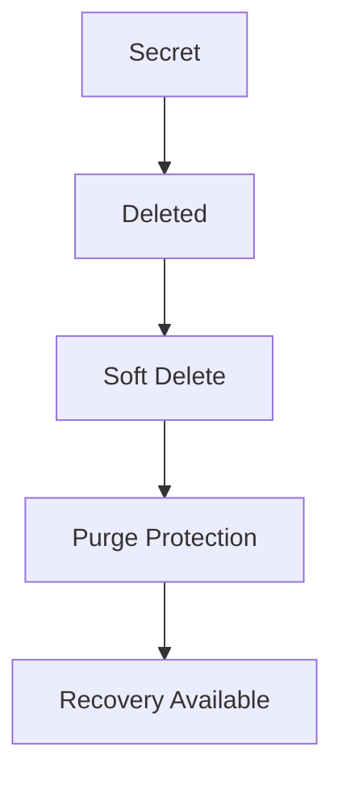

# Azure Key Vault

## Project Overview

This project focused on implementing Azure Key Vault as the centralized secrets management platform for the Azure Enterprise Infrastructure Lab.

The objective was to replace insecure credential storage methods with a secure, cloud-native solution capable of protecting secrets, keys, certificates, and application credentials.

During the project, Azure Key Vault was deployed, integrated with Azure RBAC, configured with security controls, protected using Private Link, and validated through Azure PowerShell.

This project introduced several real-world security concepts including:

- Azure Key Vault
- Azure RBAC Authorization
- Secret Management
- Secure Secret Retrieval
- Key Vault Network Security
- Private Endpoints
- Private DNS
- Defense in Depth

---

# Project Objectives

The objectives of this project were to:

- Deploy Azure Key Vault
- Implement RBAC authorization
- Store secrets securely
- Retrieve secrets using Azure PowerShell
- Implement network security controls
- Restrict Key Vault exposure
- Deploy Private Link
- Build a secure secrets management platform

---

# Why Azure Key Vault?

Modern organizations store sensitive information such as:

```text
Passwords

API Keys

Certificates

Storage Keys

Connection Strings

Encryption Keys
```

Storing secrets in:

```text
PowerShell Scripts

Configuration Files

Text Documents
```

creates significant security risk.

Azure Key Vault provides:

```text
Centralized Secret Storage

Role-Based Access Control

Encryption

Secret Lifecycle Management

Auditability
```

---

# Initial Architecture


---

# Key Vault Deployment

## Resource Details

Resource Name:

```text
keyvaults-solotech-us
```

Resource Group:

```text
RG-Management-US
```

Region:

```text
North Central US
```

Pricing Tier:

```text
Standard
```

---

# Standard Tier Selection

The Standard tier was selected because it supports:

```text
Secrets

Certificates

Keys

RBAC Authorization

Encryption
```

while avoiding unnecessary HSM costs associated with:

```text
Premium Tier
```

---

# Security Configuration

Several key security features were enabled during deployment.

---

## Soft Delete

Enabled:

```text
Yes
```

Retention:

```text
90 Days
```

Purpose:

Protect deleted objects from accidental or malicious deletion.

---

## Purge Protection

Enabled:

```text
Yes
```

Purpose:

Prevent permanent deletion of vault objects before the retention period expires.

---

# Security Protection Model



---

# RBAC Authorization Model

The vault was configured using:

```text
Azure Role-Based Access Control (RBAC)
```

instead of:

```text
Access Policies
```

This aligns with Microsoft's modern authorization recommendations.

---

# RBAC Architecture


---

# Secret Creation

A test secret was created for validation.

Secret Name:

```text
StorageAccountKey
```

Secret Value:

```text
TestSecretKey12345
```

Purpose:

Validate secret lifecycle management and Azure PowerShell integration.

---

# Secret Categories

Azure Key Vault supports:

## Secrets

Used for:

```text
Passwords

Connection Strings

API Tokens

Storage Keys
```

---

## Keys

Used for:

```text
Encryption

Signing

Customer Managed Keys
```

---

## Certificates

Used for:

```text
TLS Certificates

SSL Certificates

Code Signing
```

---

# Azure PowerShell Validation

Key Vault functionality was tested using:

```powershell
Get-AzKeyVault
```

and:

```powershell
Get-AzKeyVaultSecret
```

from:

```text
AZ-MGMT-SVR01
```

---

# Initial Challenge

Although:

```text
Owner
```

permissions existed at Subscription scope,

PowerShell returned:

```text
Forbidden
```

when attempting to access secrets.

---

# Root Cause Analysis

Investigation identified a difference between:

## Management Plane

Provides:

```text
Create 
