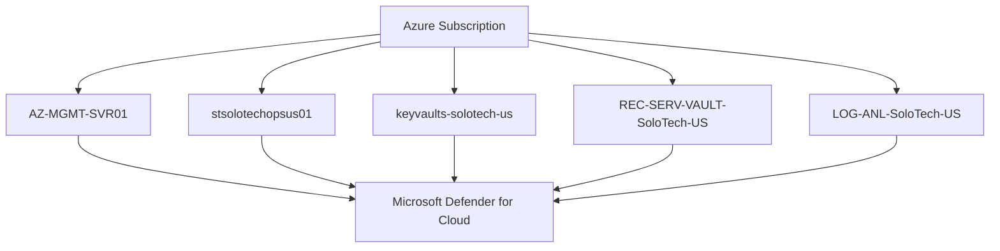
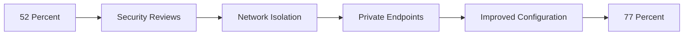
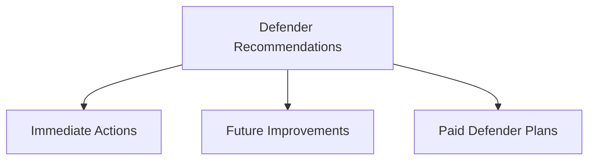
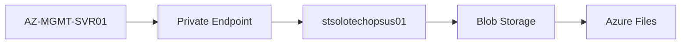

# Microsoft Defender for Cloud

## Project Overview

This project focused on implementing Microsoft Defender for Cloud to assess, monitor, and improve the security posture of the Azure Enterprise Infrastructure Lab.

The objective was to establish a centralized cloud security management platform capable of identifying security risks, evaluating infrastructure configurations, providing remediation guidance, and measuring overall security posture using Secure Score.

Microsoft Defender for Cloud was used to assess:

- Virtual Machines
- Storage Accounts
- Azure Key Vault
- Networking Components
- Identity and Access Controls
- Subscription Security Configuration
- Governance Controls

This project provided practical exposure to Cloud Security Posture Management (CSPM) concepts and Azure security best practices.

---

# Project Objectives

The objectives of this project were to:

- Deploy Microsoft Defender for Cloud
- Establish a security baseline
- Review Secure Score
- Analyze security recommendations
- Evaluate security posture
- Identify infrastructure risks
- Review Defender recommendations
- Improve Azure security controls

---

# What is Microsoft Defender for Cloud?

Microsoft Defender for Cloud is Azure's cloud security platform providing:

```text
Cloud Security Posture Management (CSPM)

Security Recommendations

Threat Protection

Compliance Assessment

Resource Security Monitoring

Secure Score Analysis
```

---

# Security Posture Architecture



---

# Initial Assessment

Microsoft Defender for Cloud was enabled and used to evaluate the Azure lab environment.

The platform immediately began assessing:

```text
Compute Resources

Storage Resources

Networking

Identity Security

Governance Controls

Recovery Services
```

---

# Secure Score

Secure Score provides a measurement of how closely an Azure environment aligns with Microsoft's recommended security controls.

---

# Secure Score Lifecycle

Initial Secure Score:

```text
52%
```

Following remediation activities and security improvements:

```text
77%
```

---

# Secure Score Improvement



---

# Security Assessment Results

Current Environment Status:

```text
Secure Score: 77 Percent

Critical Recommendations: 0

Attack Paths: 0
```

Result:

```text
No Critical Risks Identified
```

---

# Security Posture Dashboard

Microsoft Defender for Cloud provided visibility into:

```text
Overall Security Posture

Recommendation Status

Resource Health

Risk Prioritization

Security Trends
```

---

# Security Recommendations Review

The recommendations were analyzed and categorized into:

```text
Implement Immediately

Future Improvements

Paid Defender Plans
```

to avoid making unnecessary changes solely to improve Secure Score metrics.

---

# Recommendation Categories



---

# High-Value Recommendations

Several recommendations were reviewed and addressed.

---

## Periodic Update Assessment

Recommendation:

```text
Machines should be configured to periodically check for missing system updates
```

Potential Impact:

```text
19 Percent Secure Score Increase
```

Affected Resource:

```text
AZ-MGMT-SVR01
```

---

### Resolution

Reviewed:

```text
Azure Update Manager
```

Configuration:

```text
Periodic Assessment = Enabled
```

Result:

```text
Windows patch assessment enabled
```

for ongoing update visibility.

---

# Key Vault Security Review

Defender identified:

```text
Firewall should be enabled on Key Vault
```

Affected Resource:

```text
keyvaults-solotech-us
```

---

## Investigation

The existing deployment allowed:

```text
Public Network Access
```

from all networks.

This exposed the service to the public internet despite RBAC protection.

---

## Resolution

Implemented:

```text
Key Vault Firewall
```

followed by:

```text
Private Endpoint

Private DNS

Public Access Disabled
```

---

# Key Vault Security Journey


---

# Storage Security Review

Defender identified multiple storage-focused recommendations.

---

## Private Link Recommendation

Recommendation:

```text
Storage accounts should use a private link connection
```

Affected Resource:

```text
stsolotechopsus01
```

---

## Resolution

Implemented:

```text
Blob Private Endpoint

File Private Endpoint

Queue Private Endpoint

Table Private Endpoint
```

with:

```text
Private DNS Zones
```

and:

```text
Public Network Access Disabled
```

---

# Storage Security Architecture



---

# Secure Management Ports Review

Defender confirmed:

```text
Secure management ports configured
```

Affected Resource:

```text
AZ-MGMT-SVR01
```

Contributing Controls:

```text
NSG-Management

Restricted RDP Rules

Trusted Home Access Design
```

---

# Existing Security Controls
