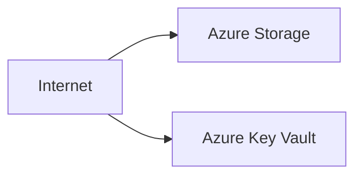
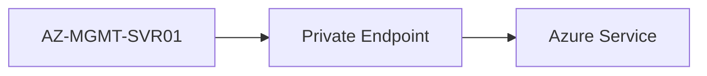
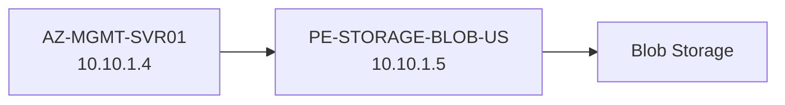
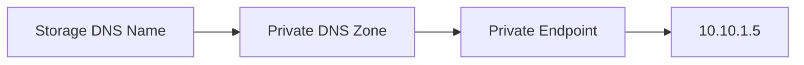
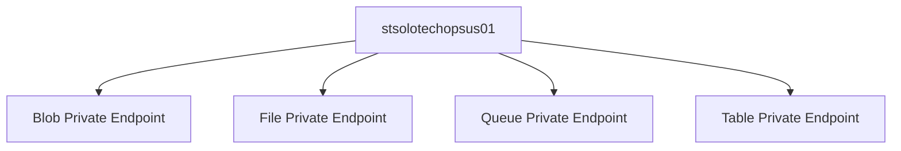
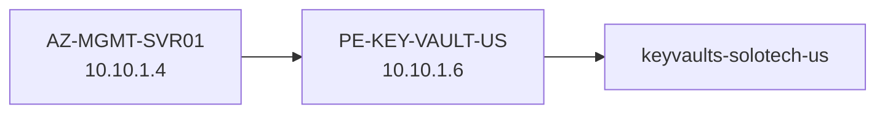
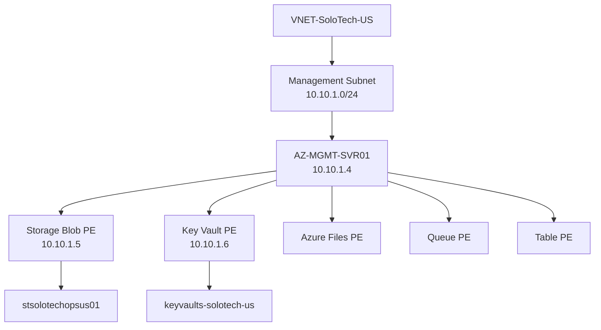

# Azure Private Link & Private Endpoints

## Project Overview

This project focused on transforming publicly accessible Azure Platform-as-a-Service (PaaS) resources into privately accessible enterprise services using Azure Private Link, Private Endpoints, and Private DNS Zones.

The objective was to remove public network exposure from critical services and integrate them directly into the Azure virtual network, creating a private cloud infrastructure model similar to a traditional on-premises corporate LAN.

The implementation included:

- Azure Storage Private Link
- Azure Key Vault Private Link
- Private Endpoints
- Private DNS Zones
- Public Access Removal
- Internal Service Routing
- Network Isolation Validation

This project represented a significant transition from cloud resource deployment to enterprise cloud architecture and security design.

---

# Project Objectives

The objectives of this project were to:

- Understand Azure Private Link
- Deploy Private Endpoints
- Implement Private DNS
- Remove public service exposure
- Restrict network access
- Improve security posture
- Address Microsoft Defender recommendations
- Build an enterprise-style Azure network

---

# Understanding the Problem

Initially, Azure services were deployed using their default configuration.

Examples:

```text
Storage Account

Key Vault

Azure Files
```

were all accessible using public Microsoft endpoints.

Examples:

```text
stsolotechopsus01.blob.core.windows.net

keyvaults-solotech-us.vault.azure.net
```

Although authentication and RBAC were in place, the services remained publicly reachable.

---

# Initial Architecture



Characteristics:

✅ Authentication Required

✅ RBAC Enabled

❌ Publicly Reachable

❌ Public DNS Resolution

❌ Internet Dependency

---

# Enterprise Networking Goal

The goal was to move services from:

```text
Public Azure Services
```

to:

```text
Private Network Resources
```

accessible only from:

```text
VNET-SoloTech-US
```

---

# What Is Private Link?

Azure Private Link enables Azure services to be accessed through private IP addresses within a Virtual Network.

Instead of:

```text
Client
↓
Internet
↓
Azure Service
```

traffic remains entirely within the Azure network.

---

# Private Link Architecture



Benefits:

- Reduced attack surface
- Internal network routing
- Improved security
- Elimination of public exposure

---

# What Is a Private Endpoint?

A Private Endpoint is a network interface assigned a private IP address inside a subnet that maps directly to an Azure service.

Example:

```text
10.10.1.x
```

becomes the internal address of a cloud service.

---

# Azure Virtual Network

Existing infrastructure:

```text
VNET-SoloTech-US
```

Management Subnet:

```text
10.10.1.0/24
```

Management Server:

```text
AZ-MGMT-SVR01
10.10.1.4
```

This network became the foundation of the private service architecture.

---

# Azure Storage Private Endpoint

## Objective

Move Azure Storage traffic off public endpoints and into the private network.

Storage Account:

```text
stsolotechopsus01
```

---

# Blob Storage Private Endpoint

Private Endpoint:

```text
PE-STORAGE-BLOB-US
```

Subresource:

```text
blob
```

Private IP:

```text
10.10.1.5
```

Subnet:

```text
Management
```

---

# Blob Storage Architecture



---

# Private DNS Integration

Azure automatically created:

```text
privatelink.blob.core.windows.net
```

and linked the DNS zone to:

```text
VNET-SoloTech-US
```

---

# DNS Transformation

Before:

```text
stsolotechopsus01.blob.core.windows.net
↓
Microsoft Public IP
```

After:

```text
stsolotechopsus01.blob.core.windows.net
↓
Private Endpoint
↓
10.10.1.5
```

---

# DNS Architecture



---

# Storage Validation

Validation Commands:

```powershell
nslookup stsolotechopsus01.blob.core.windows.net
```

and:

```powershell
Test-NetConnection stsolotechopsus01.blob.core.windows.net -Port 443
```

Results:

```text
Source:
10.10.1.4

Destination:
10.10.1.5

Connectivity:
True
```

Confirmed:

✅ Private Routing

✅ Internal DNS Resolution

✅ Successful Connectivity

---

# Azure Files Private Endpoint

Additional storage services were migrated into the private network.

Private Endpoint:

```text
PE-STORAGE-FILE-US
```

Purpose:

```text
Azure Files
```

Private network access only.

---

# Queue Storage Private Endpoint

Private Endpoint:

```text
PE-STORAGE-QUEUE-US
```

Purpose:

```text
Queue Storage
```

Private network access.

---

# Table Storage Private Endpoint

Private Endpoint:

```text
PE-STORAGE-TABLE-US
```

Purpose:

```text
Table Storage
```

Private network access.

---

# Private Storage Platform

Following deployment, the Storage Account contained private network connectivity for:

```text
Blob

Azure Files

Queue

Table
```

---

# Storage Private Link Architecture



---

# Storage Public Access Removal

After validation:

```text
Public Network Access
```

was set to:

```text
Disabled
```

Result:

```text
Internet Access

❌ Blocked

Private Access

✅ Allowed
```

---

# Azure Key Vault Private Endpoint

## Objective

Eliminate dependency on public Key Vault access and firewall allow-lists.

Resource:

```text
keyvaults-solotech-us
```

---

# Key Vault Private Endpoint

Created:

```text
PE-KEY-VAULT-US
```

Private IP:

```text
10.10.1.6
```

Subnet:

```text
Management
```

---

# Private DNS Zone

Created:

```text
privatelink.vaultcore.azure.net
```

Purpose:

Provide private DNS resolution for Azure Key Vault.

---

# Key Vault Architecture



---

# Key Vault Validation

Validation Commands:

```powershell
nslookup keyvaults-solotech-us.vault.azure.net
```

and:

```powershell
Test-NetConnection keyvaults-solotech-us.vault.azure.net -Port 443
```

Results:

```text
Source:
10.10.1.4

Destination:
10.10.1.6

Connectivity:
True
```

Confirmed:

✅ Private Endpoint Functional

✅ Private DNS Working

✅ Key Vault Reachable

✅ Internal Routing Operational

---

# Key Vault Public Access Removal

Following successful testing:

```text
Public Network Access
```

was changed to:

```text
Disabled
```

Result:

```text
Internet

❌ Blocked

Private Endpoint

✅ Operational
```

---

# Administrative Network Model

The final architecture introduced a secure administrative pattern:

```text
Home PC

↓

RDP

↓

AZ-MGMT-SVR01

↓

Private Azure Services
```

Administrators no longer access services directly from the internet.

All administration occurs through:

```text
AZ-MGMT-SVR01
```

---

# Enterprise Network Architecture



---

# Microsoft Defender Impact

This project directly addressed recommendations from:

```text
Microsoft Defender for Cloud
```

Including:

```text
Storage account should use private link

Storage account should restrict network access

Firewall should be enabled on Key Vault
```

---

# Security Benefits

Private Link provides:

- Network isolation
- Reduced attack surface
- Internal service routing
- Elimination of public exposure
- Enhanced Zero Trust design
- Improved Defender posture

---

# Lessons Learned

## Services Are Not Automatically Private

Azure services are secure by default but often remain publicly reachable.

Additional network controls are required to achieve full isolation.

---

## DNS Is Critical

Private Endpoints require private DNS resolution.

Without private DNS:

```text
Private Endpoint
```

cannot be automatically discovered by workloads.

---

## Security Requires Multiple Layers

The final architecture combines:

```text
RBAC

Private Endpoints

Private DNS

Resource Locks

Network Isolation

Monitoring
```

to create a layered security model.

---

## Cloud Networking Mirrors Traditional Networking

Azure services can be made to behave similarly to:

```text
Internal File Servers

Application Servers

Domain Services

Database Servers
```

within a traditional LAN environment.

---

# Skills Demonstrated

## Azure Networking

- Virtual Networks
- Subnets
- Private Endpoints
- Private Link

---

## DNS

- Private DNS Zones
- Internal Name Resolution
- DNS Validation

---

## Security

- Network Isolation
- Public Access Removal
- Defender Remediation
- Layered Security

---

## Azure Storage

- Blob Storage Isolation
- Azure Files Isolation
- Queue Storage Isolation
- Table Storage Isolation

---

## Azure Key Vault

- Key Vault Isolation
- Private Endpoint Integration
- Secure Secret Access

---

# Project Outcome

Successfully transformed publicly exposed Azure services into private enterprise resources within the Azure virtual network.

Achievements:

✅ Azure Private Link

✅ Storage Private Endpoints

✅ Azure Files Private Endpoint

✅ Queue Storage Private Endpoint

✅ Table Storage Private Endpoint

✅ Key Vault Private Endpoint

✅ Private DNS Zones

✅ Internal Service Routing

✅ Public Access Disabled

✅ Defender Recommendation Remediation

✅ Enterprise Network Isolation

✅ Validation Through PowerShell Networking Tests

This project established a secure private cloud architecture and significantly improved the overall security posture of the Azure Enterprise Infrastructure Lab while introducing enterprise-grade networking concepts used in production Azure environments.
