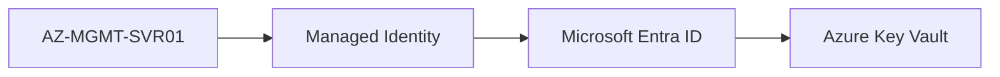

# Azure Managed Identity

## Project Overview

This project focused on implementing Azure Managed Identity to eliminate the need for stored credentials when accessing Azure resources.

A System Assigned Managed Identity was enabled on the management server and integrated with Azure Key Vault to provide passwordless authentication using Microsoft Entra ID.

This project introduced cloud-native authentication and laid the foundation for automated infrastructure operations.

---

# Project Objectives

- Implement Managed Identity
- Eliminate stored credentials
- Enable passwordless authentication
- Integrate with Azure Key Vault
- Improve security posture
- Prepare for automation workflows

---

# What is Managed Identity?

Managed Identity is an automatically managed identity in Microsoft Entra ID that can be assigned to Azure resources.

Benefits:

- No passwords
- No secret rotation
- No service accounts
- Automatic lifecycle management

---

# Architecture



---

# VM Identity Configuration

Virtual Machine:

```text
AZ-MGMT-SVR01
```

Identity Type:

```text
System Assigned Managed Identity
```

Status:

```text
Enabled
```

Azure automatically created a service principal in Microsoft Entra ID associated with the VM.

---

# Key Vault Integration

Role Assigned:

```text
Key Vault Secrets User
```

Scope:

```text
keyvaults-solotech-us
```

Purpose:

Permit retrieval of secrets while preventing administration of the vault.

---

# Validation

Authentication was tested using:

```powershell
Connect-AzAccount -Identity
```

Result:

```text
Subscription connected successfully
```

without:

- Username
- Password
- Interactive Login
- MFA Prompt

---

# Secret Enumeration Test

Command:

```powershell
Get-AzKeyVaultSecret `
-VaultName "keyvaults-solotech-us"
```

Result:

```text
StorageAccountKey

VaultAccountKey
```

Successfully retrieved using Managed Identity.

---

# Security Benefits

Managed Identity eliminates:

```text
Stored Passwords

Service Accounts

Credential Rotation

Embedded Secrets
```

while providing secure access to Azure resources.

---

# Skills Demonstrated

- Microsoft Entra ID
- Azure Managed Identity
- Key Vault Integration
- Passwordless Authentication
- RBAC Authorization
- Azure PowerShell

---

# Lessons Learned

Managed Identity simplifies Azure authentication and significantly improves the security of automation workloads.

---

# Project Outcome

Successfully implemented System Assigned Managed
