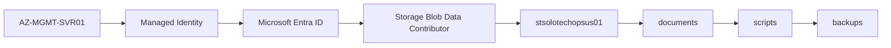

# Azure Storage RBAC

## Project Overview

This project focused on replacing storage key-based authentication with Microsoft Entra ID and Azure Role-Based Access Control (RBAC).

The management server's Managed Identity was granted direct access to Blob Storage containers using Storage RBAC.

---

# Project Objectives

- Remove dependency on storage keys
- Implement Microsoft Entra authentication
- Enable Storage RBAC
- Validate Blob Storage access
- Improve Storage security

---

# Architecture



---

# Storage Role Assignment

Role:

```text
Storage Blob Data Contributor
```

Principal:

```text
AZ-MGMT-SVR01 Managed Identity
```

Scope:

```text
stsolotechopsus01
```

---

# Authentication Model

Previous model:

```text
Storage Keys

Connection Strings

Shared Key Access
```

New model:

```text
Managed Identity

Microsoft Entra ID

Azure RBAC
```

---

# Validation

Storage Context created using:

```powershell
New-AzStorageContext `
-StorageAccountName "stsolotechopsus01" `
-UseConnectedAccount
```

No storage keys required.

---

# Container Enumeration

Command:

```powershell
Get-AzStorageContainer
```

Result:

```text
backups

documents

scripts
```

Successfully enumerated using RBAC.

---

# Blob Upload Test

Test file:

```text
ManagedIdentityTest.txt
```

uploaded successfully into:

```text
documents
```

container.

---

# Network Security Validation

Storage Account configuration:

```text
Public Network Access Disabled
```

Blob access succeeded through:

```text
Private Endpoints

Private DNS

Managed Identity
```

---

# Skills Demonstrated

- Azure Storage
- Azure RBAC
- Microsoft Entra Authentication
- Blob Storage
- Storage Contexts
- Managed Identity

---

# Lessons Learned

Storage RBAC allows resources to access storage without keys or connection strings while maintaining strong security controls.

---

# Project Outcome

Successfully replaced storage key authentication with Azure RBAC.

Achievements:

✅ Storage Blob Data Contributor

✅ Microsoft Entra Authentication

✅ Container Enumeration

✅ Blob Upload

✅ Private Storage Access
