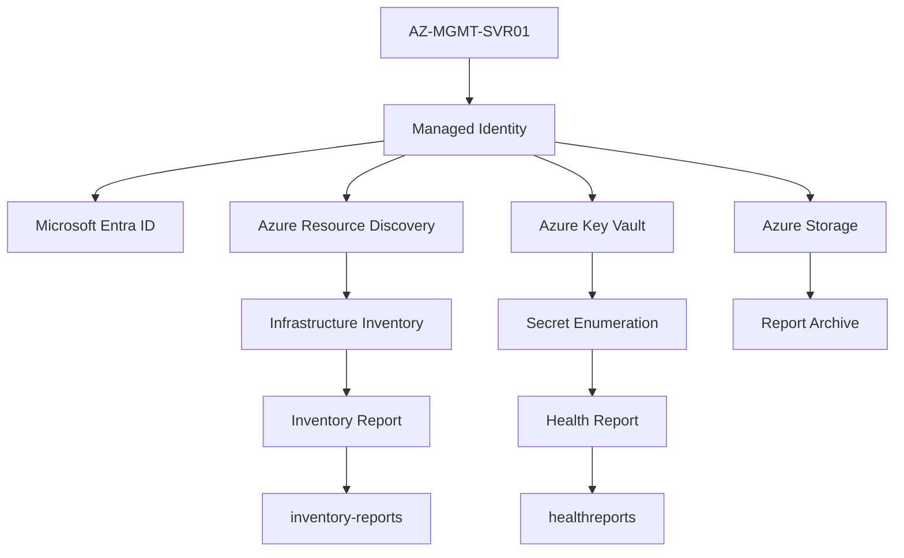
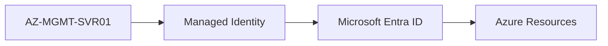
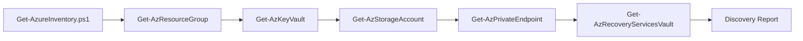
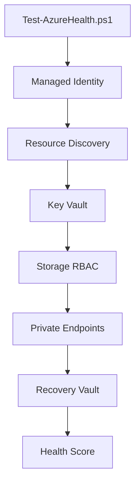
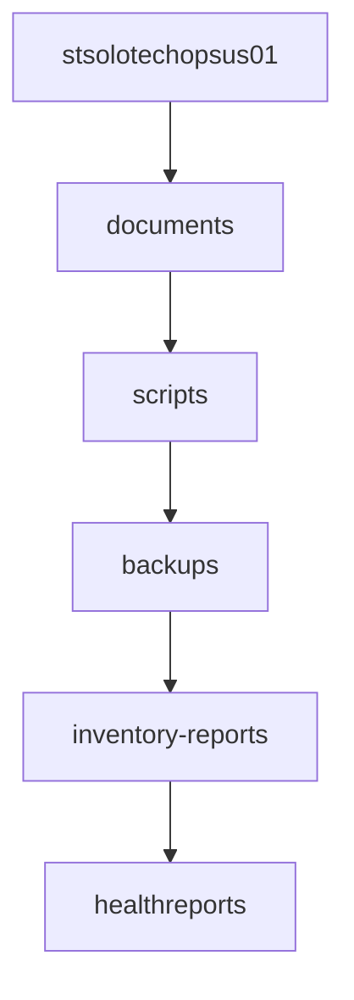
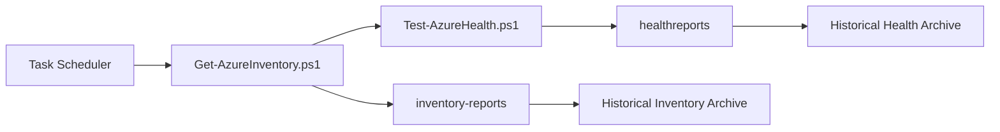

# PowerShell Automation & Operational Reporting

## Project Overview

This project focused on building cloud-native automation workflows using Azure PowerShell, Managed Identity, Microsoft Entra ID, Azure Key Vault, Azure Storage Accounts, Azure RBAC and Azure Blob Storage.

The objective was to automate infrastructure discovery, operational health validation, report generation, report archival and scheduled execution without requiring any stored credentials, passwords, connection strings or access keys.

The solution evolved into an automated operations platform capable of:

- Discovering Azure resources
- Enumerating Azure Key Vault secrets
- Validating Managed Identity authentication
- Testing Storage RBAC permissions
- Verifying Private Endpoint deployment
- Verifying Recovery Services Vault availability
- Generating timestamped operational reports
- Uploading reports to Azure Blob Storage
- Executing automatically through Windows Task Scheduler

---

# Project Objectives

The objectives of this project were to:

- Implement cloud-native automation
- Eliminate credential dependencies
- Use Managed Identity authentication
- Automate infrastructure discovery
- Implement operational health monitoring
- Archive reports automatically
- Schedule report generation
- Build real-world operational workflows

---

# Automation Architecture



---

# Environment Overview

Management Server:

```text
AZ-MGMT-SVR01
```

Authentication Method:

```text
System Assigned Managed Identity
```

Storage Account:

```text
stsolotechopsus01
```

Key Vault:

```text
keyvaults-solotech-us
```

Blob Storage Containers:

```text
documents

scripts

backups

inventory-reports

healthreports
```

---

# Authentication Model

Traditional automation typically requires:

```text
Passwords

Service Accounts

Storage Keys

Connection Strings
```

The environment was designed using:

```text
Managed Identity

Microsoft Entra ID

Azure RBAC
```

instead.

---

# Authentication Flow



---

# Script 1: Infrastructure Discovery

File:

```text
Get-AzureInventory.ps1
```

Purpose:

```text
Resource Discovery

Infrastructure Inventory

Configuration Reporting
```

---

# Inventory Functions

The script automatically discovers:

## Resource Groups

Example:

```text
RG-Management-US
```

---

## Key Vaults

Example:

```text
keyvaults-solotech-us
```

---

## Key Vault Secrets

Example:

```text
StorageAccountKey

VaultAccountKey
```

---

## Storage Accounts

Example:

```text
stsolotechopsus01
```

---

## Blob Containers

Example:

```text
backups

documents

scripts
```

---

## Virtual Machines

Example:

```text
AZ-MGMT-SVR01
```

---

## Virtual Networks

Example:

```text
VNET-SoloTech-US
```

Address Space:

```text
10.10.0.0/16
```

---

## Private Endpoints

Discovered:

```text
PE-STORAGE-BLOB-US

PE-STORAGE-FILE-US

PE-STORAGE-QUEUE-US

PE-STORAGE-TABLE-US

PE-KEY-VAULT-US

PE-FILE-US
```

---

## Recovery Services Vaults

Example:

```text
REC-SERV-VAULT-SoloTech-US
```

---

# Inventory Report Example

```text
Resource Groups    : 1

Virtual Machines   : 1

Virtual Networks   : 1

Key Vaults         : 1

Secrets            : 2

Storage Accounts   : 1

Containers         : 3

Private Endpoints  : 6

Recovery Vaults    : 1

Total Resources    : 41
```

---

# Discovery Architecture



---

# Script 2: Health Validation

File:

```text
Test-AzureHealth.ps1
```

Purpose:

```text
Operational Validation

Service Verification

Environment Health Assessment
```

---

# Health Validation Checks

The script validates:

## Managed Identity

Validation:

```powershell
Connect-AzAccount -Identity
```

Purpose:

```text
Verify Azure authentication.
```

---

## Resource Discovery

Validation:

```powershell
Get-AzResource
```

Purpose:

```text
Verify Azure control plane access.
```

---

## Key Vault Access

Validation:

```powershell
Get-AzKeyVaultSecret
```

Purpose:

```text
Verify secret access.
```

---

## Storage RBAC

Validation:

```powershell
Get-AzStorageContainer
```

Purpose:

```text
Verify Blob Storage access.
```

---

## Private Endpoint Discovery

Validation:

```powershell
Get-AzPrivateEndpoint
```

Purpose:

```text
Verify private connectivity architecture.
```

---

## Recovery Services Vault Discovery

Validation:

```powershell
Get-AzRecoveryServicesVault
```

Purpose:

```text
Verify backup platform availability.
```

---

# Health Validation Architecture



---

# Health Score Model

The script evaluates the operational status of all services.

Example Output:

```text
Managed Identity Authentication : SUCCESS

Key Vault Access                : SUCCESS

Storage RBAC Access             : SUCCESS

Private Endpoint Discovery      : SUCCESS

Recovery Vault Discovery        : SUCCESS
```

---

# Current Result

```text
Health Score

100%
```

Environment Status:

```text
HEALTHY
```

---

# Automated Report Archive

## Inventory Reports

Container:

```text
inventory-reports
```

Example:

```text
AzureReport-20261124-024026.txt
```

---

## Health Reports

Container:

```text
healthreports
```

Example:

```text
AzureHealthReport-20261124-025119.txt
```

---

# Blob Storage Architecture



---

# Scheduled Operations

Automation execution was implemented using:

```text
Windows Task Scheduler
```

---

# Scheduled Tasks

## Azure Infrastructure Inventory

Purpose:

```text
Run inventory reporting automatically.
```

---

## Azure Health Validation

Purpose:

```text
Run operational health checks automatically.
```

---

# Scheduled Execution Architecture



---

# Security Benefits

This automation platform operates without:

```text
Passwords

Service Accounts

Storage Keys

Connection Strings

Shared Access Signatures
```

instead using:

```text
Managed Identity

Microsoft Entra ID

Azure RBAC
```

throughout.

---

# Skills Demonstrated

## PowerShell

- Advanced PowerShell Automation
- Resource Discovery
- Report Generation
- Scheduled Operations

---

## Azure Identity

- Managed Identity
- Microsoft Entra ID
- Azure RBAC

---

## Azure Storage

- Blob Storage
- Storage Contexts
- Automated Uploads
- Container Architecture

---

## Azure Key Vault

- Secret Enumeration
- Secure Access
- Credential-Free Authentication

---

## Operations

- Health Monitoring
- Inventory Reporting
- Scheduled Tasks
- Report Archiving

---

# Lessons Learned

## Discovery and Monitoring Are Different

Infrastructure inventory answers:

```text
What exists?
```

Operational monitoring answers:

```text
Is it working?
```

Both functions should be implemented separately.

---

## Managed Identity Simplifies Automation

Managed Identity eliminated:

```text
Credential Storage

Password Rotation

Secret Management Complexity
```

while improving security.

---

## Cloud-Native Operations Require Layered Design

Combining:

```text
Managed Identity

Azure RBAC

Key Vault

Storage

Private Endpoints

Task Scheduler
```

produced a secure automation platform capable of supporting future enterprise workloads.

---

# Project Outcome

Successfully implemented an automated Azure operations platform capable of infrastructure discovery, health validation, scheduled execution and Blob Storage archival.

Achievements:

✅ Infrastructure Discovery

✅ Health Validation

✅ Managed Identity Authentication

✅ Azure RBAC

✅ Key Vault Integration

✅ Storage Integration

✅ Automated Report Generation

✅ Blob Storage Archiving

✅ Scheduled Operations

✅ Historical Reporting

✅ Cloud-Native Automation

This project transformed the Azure Management Server from a manually administered virtual machine into an automated cloud operations platform capable of continuous reporting and health validation.
