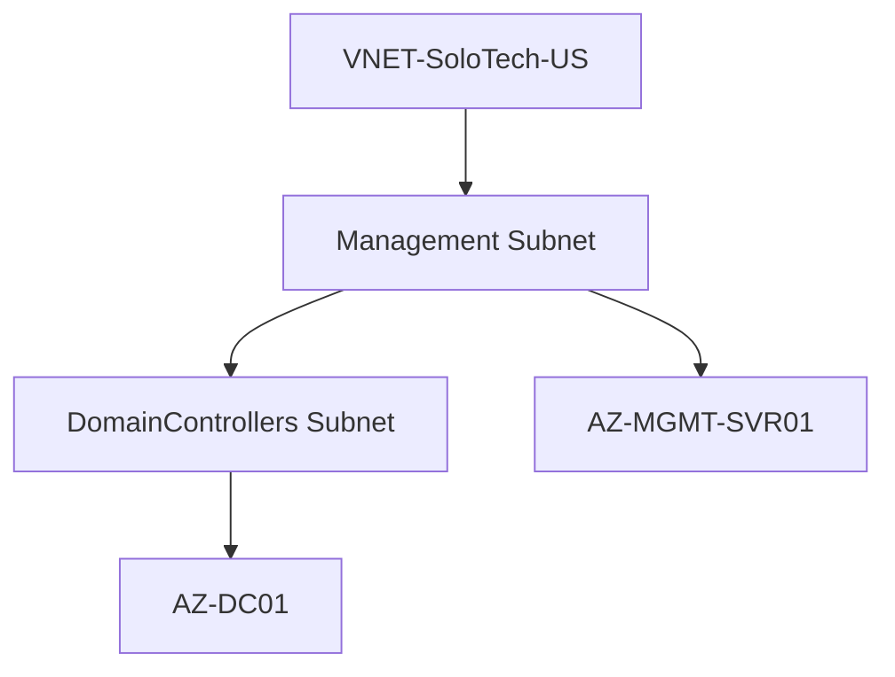
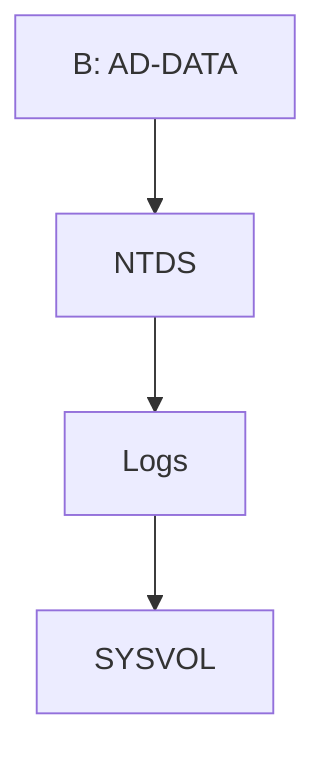

# Azure Domain Controller Deployment

## Project Overview

This project focused on deploying the first enterprise identity server within the Azure environment.

A Windows Server 2022 Domain Controller was deployed following enterprise infrastructure design principles including network segmentation, dedicated storage, backup protection, monitoring integration and private access management.

---

# Project Objectives

- Deploy first Domain Controller
- Implement secure network design
- Separate AD database storage
- Integrate with Azure Backup
- Implement monitoring
- Prepare for Active Directory deployment

---

# Infrastructure Design



---

# Virtual Machine Configuration

Name:

```text
AZ-DC01
```

Operating System:

```text
Windows Server 2022 Datacenter Azure Edition
```

Size:

```text
Standard_B2als_v2
```

---

# Storage Design

## OS Disk

Purpose:

```text
Windows Server
```

---

## AD-DATA Disk

Size:

```text
64 GB
```

Drive:

```text
B:
```

Label:

```text
AD-DATA
```

---

# AD Storage Layout

Created:

```text
B:\NTDS

B:\Logs

B:\SYSVOL
```

Architecture:



---

# Security Configuration

## Public Access

```text
No Public IP
```

---

## Network Security Group

```text
NSG-DomainController
```

Rule:

```text
Allow-RDP
```

Source:

```text
10.10.1.0/24
```

Destination:

```text
10.10.2.0/24
```

Port:

```text
3389
```

---

# Backup Configuration

Recovery Services Vault:

```text
REC-SERV-VAULT-SoloTech-US
```

Policy:

```text
EnhancedPolicy
```

---

# Monitoring Configuration

Enabled:

```text
Boot Diagnostics

Guest Diagnostics

Managed Identity
```

---

# AD DS Installation

Command:

```powershell
Install-WindowsFeature `
AD-Domain-Services `
-IncludeManagementTools
```

Validation:

```powershell
Get-WindowsFeature AD-Domain-Services
```

Result:

```text
Installed
```

---

# Lessons Learned

Dedicated storage volumes improve Domain Controller design and provide separation between operating system files and Active Directory data.

---

# Project Outcome

Successfully deployed Azure Domain Controller infrastructure.

Achievements:

✅ AZ-DC01

✅ Dedicated Domain Controller Subnet

✅ Dedicated AD Storage

✅ Backup Integration

✅ Monitoring Integration

✅ AD DS Installation
