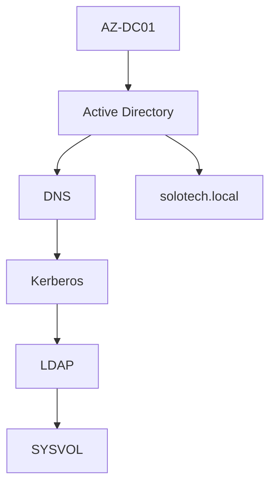

# Active Directory Forest Deployment

## Project Overview

This project introduced enterprise identity services into the Azure platform by creating the first Active Directory forest.

AZ-DC01 was promoted to a Domain Controller and configured as the first Domain Controller, first DNS server and forest root for the environment.

---

# Project Objectives

- Create Active Directory Forest
- Deploy DNS
- Configure Kerberos
- Configure LDAP
- Configure SYSVOL
- Establish enterprise identity platform

---

# Forest Creation

Command:

```powershell
Install-ADDSForest `
-DomainName "solotech.local" `
-DomainNetbiosName "SOLOTECH" `
-DatabasePath "B:\NTDS" `
-LogPath "B:\Logs" `
-SysvolPath "B:\SYSVOL" `
-InstallDNS
```

---

# Forest Information

Forest Name:

```text
solotech.local
```

NetBIOS Name:

```text
SOLOTECH
```

Domain Controller:

```text
AZ-DC01
```

---

# Architecture



---

# DNS Configuration

Post-Promotion DNS:

```text
127.0.0.1

::1
```

Purpose:

```text
Self-hosted Active Directory DNS
```

---

# Validation

## Domain Validation

Command:

```powershell
Get-ADDomain
```

Validated:

```text
solotech.local
```

---

## Authentication Validation

Command:

```powershell
whoami
```

Result:

```text
SOLOTECH\Administrator
```

---

# Troubleshooting Case Study

## Network Adapter Failure

During post-installation testing the Ethernet adapter was disabled from within the guest operating system.

Result:

```text
Loss of RDP Connectivity

Loss of Network Connectivity

Azure Run Command Issues
```

Recovery Tools Used:

```text
Boot Diagnostics

Azure Serial Console

Guest NIC Reset
```

---

# Recovery Procedure

Using Azure Serial Console:

```cmd
netsh interface set interface "Ethernet" enable
```

Network connectivity was successfully restored.

---

# Lessons Learned

Cloud virtual machines should not have their primary network adapter disabled during troubleshooting.

Unlike on-premises servers, management access depends entirely on network availability.

Azure troubleshooting features provide powerful recovery capabilities when guest networking failures occur.

---

# Project Outcome

Successfully implemented enterprise identity services in Azure.

Achievements:

✅ Active Directory Forest

✅ DNS Deployment

✅ Kerberos Authentication

✅ LDAP Services

✅ SYSVOL Configuration

✅ Enterprise Identity Platform

✅ Azure Recovery Tool Experience
