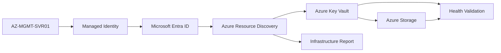
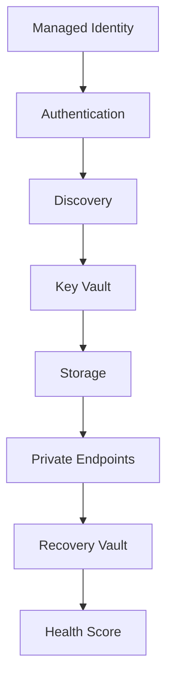

# Azure Infrastructure Discovery & Health Reporting

## Project Overview

This project focused on building cloud-native automation using Managed Identity, Azure PowerShell, Azure Key Vault, and Azure Storage.

Two operational scripts were created:

```text
Get-AzureInventory.ps1

Test-AzureHealth.ps1
```

The solution provides infrastructure discovery, reporting, health validation, and automation readiness.

---

# Project Objectives

- Discover Azure resources automatically
- Generate infrastructure reports
- Validate platform health
- Implement cloud-native automation
- Eliminate credential dependencies

---

# Solution Architecture



---

# Script 1 - Infrastructure Discovery

File:

```text
Get-AzureInventory.ps1
```

Purpose:

```text
Inventory Reporting
```

Discovers:

- Resource Groups
- Virtual Machines
- Virtual Networks
- Key Vaults
- Storage Accounts
- Blob Containers
- Private Endpoints
- Recovery Services Vaults

---

# Infrastructure Discovery Report Example

```text
Resource Groups : 1

Virtual Machines : 1

Virtual Networks : 1

Key Vaults : 1

Secrets : 2

Storage Accounts : 1

Containers : 3

Private Endpoints : 6

Recovery Vaults : 1

Total Resources : 41
```

---

# Script 2 - Health Validation

File:

```text
Test-AzureHealth.ps1
```

Purpose:

```text
Operational Validation
```

Validates:

- Managed Identity Authentication
- Resource Discovery
- Key Vault Access
- Secret Enumeration
- Storage RBAC
- Private Endpoint Discovery
- Recovery Vault Discovery

---

# Health Validation Architecture



---

# Health Score Model

Health checks performed:

```text
Managed Identity Authentication

Resource Discovery

Key Vault Access

Storage RBAC Access

Private Endpoint Discovery

Recovery Vault Discovery
```

Current Result:

```text
Health Score

100%
```

Status:

```text
HEALTHY
```

---

# Benefits

The reporting solution provides:

- Automated infrastructure discovery
- Security validation
- Resource inventory
- Operational monitoring
- Cloud-native authentication

without:

```text
Passwords

Connection Strings

Storage Keys

Embedded Credentials
```

---

# Skills Demonstrated

- Azure PowerShell
- Managed Identity
- Azure Automation
- Microsoft Entra ID
- Azure Resource Discovery
- Azure Storage
- Azure Key Vault
- Monitoring & Reporting

---

# Lessons Learned

Infrastructure discovery and health validation are separate operational concerns and should be implemented as independent automation workflows.

---

# Project Outcome

Successfully implemented Azure automation and reporting capabilities for the Azure Enterprise Infrastructure Lab.

Achievements:

✅ Infrastructure Discovery

✅ Health Validation

✅ Resource Enumeration

✅ Automated Reporting

✅ Managed Identity Authentication

✅ Key Vault Integration

✅ Storage Integration

✅ Cloud-Native Operations
